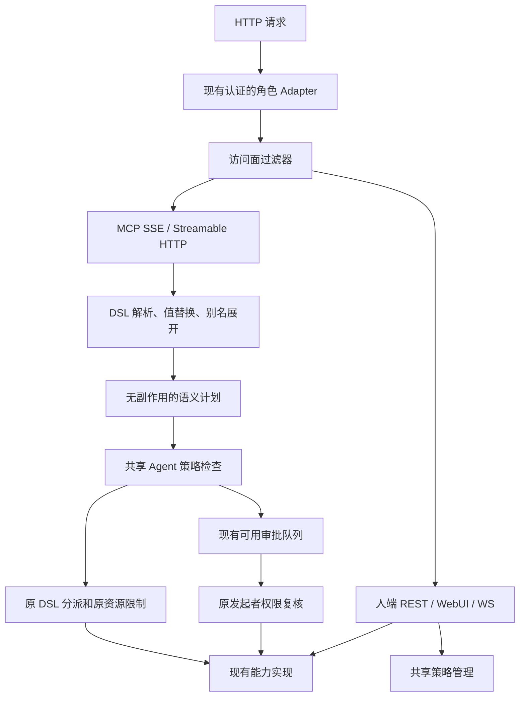

# Agent 权限过滤器实施方案

状态：设计，未修改业务源码。日期：2026-10-27。核验基线：`dev@6a8af551206ef2dcd73abbf47871ac90b4fa568f`。

范围说明：函数位置和内容哈希固定到上述 Git 提交；阅读期间工作区另有配置加密开发，本方案未修改那些业务文件，也未将其未提交变化混入基线证据。

本文把 [权限需求](agent-permissions.md) 收敛为当前代码可以实施的方案。涉及源码位置以本文及 [函数证据表](agent-access-implementation-evidence.csv) 为准；旧调用审计固定在 `76b3209`，不能把旧行号、714 个连接点或 98 项对照直接当作新版覆盖结果。

后续接入设计见 [人与 Agent 的身份与凭据签发机制](auth-issuance.md)。选择该方案时，以其中的 Admin 登录、Agent token、可选配对、续期和撤销流程替代本文第 4 节的静态凭据过渡方案；本文其余业务权限约束继续适用。两份方案均未实现。

## 1. 实施结论与范围

在 MCP 的 DSL 语义出口增加统一过滤器，在 HTTP 入口增加可信角色和访问面检查，在审批恢复处复核原发起者权限。WebUI 的人类业务操作保留现有调用路径。两条入口共用操作目录、目标归属规则和权限管理 Module，不强制通过同一个 HTTP middleware 执行业务权限判断。

第一版实现一份共享 Agent 策略，配置操作、主机范围和公共词汇；不实现单个 Agent 覆盖、用户/组、cookie 或 token 签发、委派和吊销链。Agent 只进入 MCP；`POST /api/term` 即使使用同一 DSL，也属于人端 REST。

完整命令模式解耦是独立后续阶段，见 [命令模式方案](command-decoupling.md)。本次不需要先将全部 Manager/Store 调用改造成命令对象。如果同时推进解耦，应把保持行为的重构与新增权限行为拆开验收。

主机配置继续逐条存储，加密工作见 [配置加密方案](config-encryption.md)。权限层通过 Store 读取安全摘要，不负责加解密；本期不加密会话或历史。人主动读取、导出原文沿用人端路径，允许默认明文和自选导出密码；Agent 的业务摘要不包含凭据原文。

## 2. 当前代码的实际接缝

以下均核对了当前函数体及调用关系，位置是本次基线的函数起始行。

| 当前位置 | 已验证行为 | 实施动作 |
| --- | --- | --- |
| `main.go:316`，`runServer` | 注册 `/sse`、`/message`、`/stream`、`/api/term`，WebUI 持有同一组 Manager/Store；整棵 mux 外只有现有认证 | 在这里装配共享策略、角色识别、访问面检查、审批回调 |
| `internal/auth/auth.go:202`，`Middleware` | 一套 Verifier 接受 Bearer/Basic/cookie；通过后没有设置人/Agent 角色 | 增加可信 Actor Adapter；不能按 URL、loopback 或 clientInfo 推断身份 |
| `internal/mcp/origin.go:51`，`withRequestContext` | 显式组合 origin 与 namespace；SDK context hook 只有一个槽位 | 在同一个函数中显式传递 HTTP Actor；两种 MCP transport 都验证 |
| `internal/mcp/term.go:264`，`executeTerm` | 正常解析、解析失败后别名展开、空命令 guide 是三个分支 | 三个分支都纳入权限，保留原语法和错误处理 |
| `internal/mcp/term.go:398/420`，两个 statement 执行函数 | 并行和顺序路径分别展开别名，再调用 `runDirective` | 统一带上原始词汇及展开链，不在两条路径各写一套判断 |
| `internal/mcp/term_directives.go:29`，`runDirective` | 集中分派 19 个动词；既有 handler 调用，也有 peer/task/列表直达路径 | 在旧函数体之前建立语义 Hook，覆盖直达路径 |
| `internal/mcp/term.go:771`，`callTool` | 经 `withLogging` 再进入 `checkAdmission` 和 handler | 保留现有检查；核对真实内部调用与已授权计划是否一致 |
| `internal/mcp/guard.go:174/197`，两个会话解析函数 | 解析存活 shell/session 时可能调用 `extensions.Touch` | 权限预检使用不续租的查询；拒绝时不得延长扩展寿命 |
| `internal/mcp/handlers_extension.go:219/256` | `use` 调用 `Acquire`，`release` 调用 `Release` | `open/close ext` 在进入这两个函数前检查动作及主机 |
| `internal/mcp/term_task.go:20/44/61` | 直接调用任务 Await/List/Cancel，不经 `callTool` | 由语义 Hook 和任务归属元数据覆盖 |
| `internal/mcp/copy_stream.go:42` | 管道读取源后，直接启动独立 context 的异步复制任务 | 启动前检查源和目的全部权限，记录两个主机 |
| `internal/mcp/term_generated.go:1323`，`termGuide` | 空命令直接读取扩展和当前会话列表 | 动态内容使用过滤后的数据，不能把空命令整体视为公开信息 |
| `internal/mcp/approval_gate.go:198` | 审批后直接调用 handler，使用新建的 background context | 恢复原 Actor 和资源计划，执行前重新检查 |
| `internal/webui/approval.go:253` | 普通操作转 MCP 回放；终端输入/按键直接执行 ChildShell 方法 | 两个分支之前增加同一个复核回调，不能只修 MCP 回放 |
| `internal/webui/ws.go:303` | 人端终端检查资源能力表后直接写入，不经过 MCP 审批 | Agent 在 WS 升级前拒绝；人端路径保留 |

这不是最新版的全量调用审计。此次使用本机 Go AST/类型分析定位调用，再阅读与方案相关的源码；证据表固定记录 69 个函数的路径、声明行、结束行、限定符、源文件 SHA-256 和提交号。图谱没有本项目索引，索引 worker 曾失败；coverage 请求也不能提供有效覆盖保证，因此结论以源码核验为依据。平台专属路径未重新做三平台全量审计。

## 3. 目标调用结构



这里有三个不同的检查：

1. 入口检查：这个可信角色能否进入这类 transport。
2. 业务检查：这个 Agent 能否对这些主机执行这组操作和参数。
3. 资源检查：现有 namespace、模板 `allow/paths`、部署开关和资源状态是否允许。

任何一项拒绝都不能被另一项允许覆盖。人端不使用 Agent 策略，但继续执行现有资源限制。审批是保留原意图的一次执行许可，不是把 Agent 临时提升为人。

## 4. 可信角色：最小接入，不做签发体系

当前没有可信人/Agent 区分，这是执行入口隔离的前置依赖。仅在 MCP handler 中填 `role=agent`，会让同一调用者换到 REST 后变成人，不能满足要求。

建议在 `internal/auth` 增加 `Actor` 及私有 context key：角色为 `human`、`agent`、`unknown`，读取函数导出，构造与写入只由受信任的服务端 Adapter 使用。可保留内部关联 ID，但本版不拿它查个体策略。

具体接法复用当前 Verifier：现有人端认证配置不变；新增可选 `AgentAuthHash` 配置及 `TERMCP_AGENT_AUTH_HASH` 环境变量，只接受预先配置的 Agent Bearer 凭据。它只负责验证已有凭据，不新增签发、登录、cookie 管理或 token 生命周期接口。人的现有 Basic/cookie 行为保留。

| 情况 | 处理 |
| --- | --- |
| 凭据只通过人端校验 | 服务端写入 human Actor |
| 凭据只通过 Agent 校验 | 服务端写入 agent Actor |
| 同一凭据同时通过两类校验 | 拒绝，不能通过优先级选较宽角色 |
| 显式 Authorization 无效，同时夹带有效 cookie | 拒绝显式凭据，不向人端 cookie 降级 |
| 业务入口缺少可信角色 | 拒绝，不默认当人 |
| 匿名公开文档 | 保留公开文档规则；若请求已有可信 Agent 身份则仍检查访问面 |

配置 Agent 角色时必须同时启用人端认证；`DisableAuth` 与此模式不兼容。旧部署没有配置 Agent 校验器时可以保持旧认证行为，但必须明确处于旧接入模式，不能宣称已隔离 Agent。若本期连新增静态校验配置也不接入，则只能交付权限内核及配置预览，无法交付可靠的人/Agent 入口隔离。

`withRequestContext` 必须从 `r.Context()` 取已认证 Actor，写到 SDK 交给工具的 context；不要额外安装一个覆盖 origin/namespace 的 SDK context hook。每条 MCP HTTP 消息重新验证角色。MCP transport 会话还要绑定建立时的角色，拒绝 Agent 复用人端 transport session ID；这不等于逐 Agent 业务资源隔离。stdio 桥转发 Agent 凭据，不因为访问 loopback 获得 human 角色。

入口白名单使用注册的确切路由和方法：`GET /sse`、`POST /message`、`/stream` 的 SDK 支持方法。注册 MCP handler 时给 handler 标注 transport 类别，或使用 mux 匹配到的确切 pattern；不使用 URL 子串判断。未知页面、REST fallback 和 WS Upgrade 对 Agent 均拒绝。

## 5. 权限 Module 和最小 Interface

新增 `internal/access`，只依赖中性元数据与可信 Actor，不导入 `mcp`、`webui`、`session`、SFTP 或扩展运行时。实际资源解析放在 MCP Adapter；权限判断本身不执行 IO。

建议的 Interface 如下，字段细节可随实现调整，但职责不能混合：

```go
type Effect string // deny / ask / allow
type OperationID string
type HostKey string // 第一版为规范 profile 名；internal 单列

type Requirement struct {
    Operation OperationID
    Hosts     []HostKey
    Params    Facts // 按操作注册的类型化事实；不能装任意执行闭包
}

type Plan struct {
    Vocabulary  VocabularyTrace
    Requirements []Requirement
}

// Actor 来自可信认证 Adapter；Plan 来自服务端解析器。
func (e *Engine) CheckSurface(actor auth.Actor, surface Surface) Verdict
func (e *Engine) Check(actor auth.Actor, plan Plan) Verdict
func (e *Engine) Snapshot() PolicyView
func (e *Engine) Replace(expectedRevision uint64, next PolicyInput) (PolicyView, error)
```

`Verdict` 包含决策、策略 revision、拒绝原因码和命中的操作，不能携带通用“跳过鉴权”开关。Actor 和原始权限计划不接受客户端 JSON 反序列化。预览使用同一个 `Check`，不复制一套规则。

目录中的每个操作声明：规范操作 ID、词面形状、目标解析种类、动作参数 schema、对应旧 capability ID、审批支持方式、是否 Agent 可达。UI 词树从目录生成；`capability` 中现有资源限制和审批元数据继续复用，不平行复制整张表。

## 6. MCP Hook 的具体实现

### 6.1 统一执行位置

保留 `runDirective` 作为公共内部入口，将旧分派函数体移到 `runDirectiveBody`。新入口按下列顺序执行：

1. 获取已展开 statement 和服务端词汇 trace。
2. 进行无副作用的形状校验与计划构建；未知动作/分支拒绝。
3. 使用不续租的解析器解析现存目标及主机；批量目标全部预检。
4. 对 Agent 检查词汇、主机、动作、参数，得到 allow/deny/ask。
5. 在允许或有安全审批承接后进入旧函数体，执行原有 namespace、资源限制、错误映射及业务流程。

人调用同一 DSL 时保留原业务行为，不新增 Agent 策略拒绝；只复用中性的语义描述。权限启用后，Agent 拒绝的错误优先于旧业务错误是预期变化，不能伪称“完全无行为变化”。

计划构建不能调用会续租的 `sessionForShellID/sessionForSessionID`，不能 `Acquire`、拨号、启动 session/task、修改 cursor、stage 输入或取消任务。可以基于 `lookupSessionID` 提取只读 lookup，但各目标种类仍保留原 resolver 的接受范围，不能因此把一种命令原本不接受的地址也放行。

需要把少量“实际动作是什么”的纯解析函数从旧分派中抽出，给计划和执行共同使用，例如文件 action/sub-op、forward 方向、`edit ext --restart`。这是消除语义漂移所需的局部重构，不是给每个子命令手写权限判断。

### 6.2 内部 handler 的核对

`callTool` 的旧链 `withLogging → checkAdmission → handler` 保留。在 `checkAdmission` 的原资源解析之前增加 Agent 调用核对：实际 tool/action/目标/参数必须被当前服务端计划覆盖。计划不存在或分支不匹配则拒绝；不能让外层只允许了读，内层执行了写。

计划凭据保存在服务端私有 context 值中，绑定规范目标、实际参数及 revision。内部调用不是一次新的用户申请，不重复提交审批；如果它揭示计划未覆盖的能力，返回实现错误并拒绝。后续 statement、审批回放和新请求使用当前策略。不能仅凭 `withInnerCall` 或 `approvedContext` 跳过新的权限检查。

无 handler 的 peer、task、列表、管道路径已经由 `runDirective` Hook 覆盖；它们还需使用已核准的规范目标，不能执行时重新解析成另一个对象。若资源版本或对象已替换，应重新计划或拒绝，不能悄悄转向。

### 6.3 必须区分的语义

下表是具体映射约束；新 ID 是提案，不表示当前 `capability` 已有这些细分项。操作目录要为每个可达分支落行，不能只登记表中的动词。

| DSL / 分支 | 规范操作与约束 |
| --- | --- |
| `connect`；`open` 普通通道 | `session.start`；`shell.open`；显式 `--argv` 或启动程序覆写额外要求 `shell.exec`，不能只凭建连权执行任意程序 |
| `run` | 在写入前合并 `shell.input`、`shell.key`、实际请求的 `shell.output`；不能先输入再因读权不足报错 |
| `input`、`key`、`resize` | 分别是 `shell.input/key/resize`，不等于允许全部终端动作 |
| `span` | 规范名 `shell.marks`，复用旧 `session.message` 资源限制；实际调用 `callTool("message")` |
| `reader` / `reader --drop` | `shell.reader.register/unregister` |
| `get` session/channel；`ls` | info/list；列表逐项按主机过滤，session/shell/forward/peer/task/ext/host 分开登记 |
| `get host` / `get ext` | `profile.get` / `ext.get` 安全摘要；不能顺带返回凭据/扩展 headers |
| `get file` 默认；`--op stat/realpath/readlink/getwd/statvfs/urls` | 对应独立元数据动作；`urls` 返回的仅是人端 URL，不授予 Agent REST 访问权 |
| `get/write file --op chmod/chown/chtimes/truncate` | 规范为独立写操作；旧 `file.perm/file.fs` 仍作资源上限，不能因动词叫 get 当作只读 |
| `read` channel/file/peer | `shell.output` / `file.read` / `peer.read`；`--frame/--since/--at` 对应真实分支 |
| `write file`、`--old-text`、仅 `--mode` | `file.write`、`file.replace`、`file.chmod`；从同一纯 action resolver 得出 |
| `create file`；`--target`；`--target --op link` | `file.mkdir`、`file.symlink`、`file.link` |
| `rm` file/session/host/ext/alias | 分别是删除对应对象；不能因为允许 start 就允许删除 |
| `close` channel/session/forward/peer/task/ext | 分别是关闭通道、终止连接、关闭转发、关闭 peer、取消任务、释放扩展；`--forward-id` 也归 forward.close |
| `open ... forward` local/remote/dynamic | 三个可分别配置的动作，共同受旧 `forward.open` 限制 |
| `open` MCP/CDP/JRPC peer；`--target` | `peer.open` / `peer.attach`；主机来自父 session，endpoint/method 参数保留在计划 |
| `call` 工具名；raw JSON `tools/call` | 同样解析成 `mcp.tool.invoke`，检查相同 tool name 与 arguments schema；`--send` 不能避开检查 |
| `call` 其他 JSON-RPC/CDP method | `peer.call` 加 method/参数限制；无法理解的 raw frame 需要独立 `peer.raw`，缺省禁止 |
| `create/edit host/ext`、`edit ext --restart` | 配置变更与 `ext.retry` 分开；改变凭据目标、启动程序、限制、审批设置不是安全的普通元数据编辑 |
| `open/close ext` | `ext.use/release`，不能继续拿 `ext.get` 当启动扩展的充分权限 |
| `read ... \| write ...` | 源读取 + 目的写入 + 两端主机；任一拒绝都不读、不启动任务 |
| `help`、`notify`、alias 相关分支 | 静态帮助、通知和公共 alias 管理独立登记；Agent 不得修改自己的有效词汇授权 |

当前 `ls <session> file` 明确拒绝；不要因为 WebUI 有目录浏览就新增 Agent 的 DSL `file.list` 路径。`file.rename` 等只有旧 handler 或能力声明而没有当前公开词面的操作，在目录标记不可达，不能生成一个可用 UI 开关。

词面权限只判断 Termcp 的 DSL。禁止 `rm session` 不会禁止获准的终端输入里执行 shell 的 `rm`。如果允许任意终端输入、程序启动或泛化 peer method，就相应授予了这类执行能力；不能用字符串黑名单承诺进程沙箱效果。

## 7. 主机归属、列表和敏感字段

### 7.1 主机标识的实际落地

当前 `sshconfig.Entry` 没有 UUID 或通用 tags，session 用 `SSHConfig` 保存 profile 名称。第一版使用经过 Store 同样规范化/校验的 profile 名作为 `HostKey`，`internal` 是一个独立值。选择器只实现 `all / selected / none`，初始为 all，包含以后新增且部署允许的主机。

这是一项对旧草案的收敛：UUID、改名保留身份、删除重建不继承权限，需要单独做 profile 身份迁移；不能假装已经存在。名称模式下，同名重建会重新命中该名称的授权，UI 需要明确提示。profile 的创建、删除、改名及敏感编辑默认留给人端。

保留 `HostSelector` 的解析接缝，以后把标签解析成 HostKey 集合，再交给同一过滤器；本版不新增 tags 字段或空有其名的标签控件。namespace、扩展模板 `allow/paths` 继续生效，均不能扩大共享主机范围。

| 对象 | 解析主机的方法 |
| --- | --- |
| 已有 session/shell/reader/输出 | 从规范 session 快照的 SSHConfig 取 profile 名，不从客户端声明取 |
| 建连、profile 摘要 | 从已规范化的 profile 名解析；不允许 Agent 用原始连接参数绕过受管 profile |
| ext use/release/retry | 从存储的扩展 Target 解析真实目标；所有实例同样检查；不确定目标则拒绝 |
| forward/peer | 从其实际父 session 取主机 |
| 文件 | 从实际目标 session 取主机；本地中转路径另计 internal 主机 |
| transfer task | 创建时保存源/目的全部 HostKey；get/list/cancel 不从展示字符串猜测 |

`task.View` 目前只有一个 SessionID，复制把源描述放在 LocalPath，不能可靠还原两端。给 task 增加中性的私有资源归属元数据和只读获取方法；download/upload/copy 三处 Start 调用同时登记。旧进程内无归属记录对 Agent 不可见/不可取消，人端行为保留。

### 7.2 先过滤数据，再格式化和记录日志

`directivePS/Info/LS`、任务列表、host/ext 列表及 `termGuide` 都使用同一主机可见性谓词。先得到有权资源快照，再算数量、选择提示和生成 envelope；不要先拼完整文本再用正则删除行。批量写操作全部预检，禁止目标不能先被部分执行。

`handleGetSSHConfig` 当前直接返回 private_key、proxy；`extensionConfigMap` 返回 headers、command/args/url。给 Agent 使用独立白名单 DTO：连接摘要只含安全标识/类型/状态和凭据存在性，扩展摘要只含安全说明、目标和运行态。headers、凭据字段、带认证信息的 URL/proxy、任意启动参数不进入 Agent 摘要。嵌套 Jump 同样投影。

投影应在 `jsonResult` 及内层 `withLogging` 记录 output_preview 之前完成；外层响应脱敏无法清掉已经写入的内层日志。人端原文编辑/导出接口只经过 human 入口限制。存储解锁、改密、审批、权限管理、daemon 管理等人端管理操作不向 Agent 开放。

这些约束保护 Termcp 接口直接返回的凭据。授予 internal 的任意 shell/文件读取，或相同 OS 账号的远程终端权限，仍可能让调用者触达其他本机文件；本方案不是 OS 隔离，也不声称阻断已授予主机执行能力带来的全部数据访问。

## 8. 公共别名与直接词汇

公共词汇有 `standard` 和 `assigned_aliases` 两种模式。后者限制用户直接输入的词，不额外给展开后的动作授权。别名内部仍检查全部操作、主机和参数。

当前别名有两条展开入口：正常 statement 的 `aliases.Expand`，以及解析报错后 `expandErrorCycle`。给两条路径共用的解析结果增加服务端 `VocabularyTrace`，记录原始入口、别名链和定义版本。不能仅在 `runDirective` 看最终动词；那时原词已经丢失。

一次计划使用同一别名快照展开并执行，不能批准后按新定义再次展开。公共别名的授予/收回由人端策略管理；Agent 创建同名 runtime alias 或扩展发布 alias，都不能篡改已授予的定义。建议第一版把 alias create/edit/delete 作为人端管理动作；Agent 可查看分配给自己的公共词汇。

保留别名现有替换语义；只有明确受限的值槽允许公共词汇参数化，不能靠参数注入新增 DSL 语句。不要为了权限功能顺手重写现有 parser。未来 #196 的专属词汇、短路和内嵌创建仍需产生同一规范计划，本版不实现这些语法。

## 9. Ask 和审批恢复

`Capability.Reviewable()` 不等于当前能安全支持所有 ask。`gateOperation` 在无 session 时不入队，且只有资源已启用对应 review scope 才排队；回放只处理可映射 handler，成功结果目前丢弃。不能把 session.start、查询、raw peer、copy/task 或任意扩展动作标成全支持。

目录为审批支持区分 `none / existing_operation / staged_input`。第一版只对已有可完整保存、排队和回放的操作提供 ask：

1. 预检原 session 的队列和 scope 是否已支持该操作；缺少时返回 `review_unavailable`，不退化为 allow。
2. 不自动把整个 session 的 review 开关打开，不改变人的输入路径。
3. `writeShellInput/pressShellKey` 在真实写入点再次确认 ask 的排队条件；若预检后资源 review 被关闭，则拒绝，不能直写。
4. staged text、key 合成完整请求时保存所有需求。input=ask、key=allow 时提交仍需审批；input=deny 时不得暂存。
5. `approval.Request` 或其受控扩展元数据保存原 Actor、规范资源、完整参数及策略 revision；数据由服务器提交路径产生，不接受批准表单覆写。
6. `webui.executeApproved` 两分支前调用同一个 `AuthorizeApproved` 回调，普通操作回放再核对规范参数。重新按当前策略和资源上限检查原 Agent；人只是批准者。

复核结果为 deny 或主机已移出范围则不执行；仍为 ask 且该完整请求已获批准，则仅放行这个固定操作的一次执行；不重新入同一审批队列。`withApproved` 只抑制重复排队，不绕过业务权限、资源限制或目标核对。

已有无 Actor 元数据的待审记录不能在启用新机制后猜测发起者；标为需要重新提交，由人清理。若同时在做纯命令解耦，旧记录处理和复核都属于后续明确的权限行为变更，不能混入保持行为的阶段。

策略变化对下一 statement、新调用和待审回放生效。已经开始的终端写入或后台传输不自动撤回，不能承诺零时差吊销已发出的字节；第一版也不隐式新增批量终止任务机制。

## 10. 策略存储和人端管理

### 10.1 一份可审阅的配置

新增 `data-dir/agent-policy.toml`，采用现有 TOML 依赖；不保存凭据。不新增 `agents`、group、继承、override、token 字段。最小示例：

```toml
schema_version = 1
revision = 1

[hosts]
mode = "all"
names = []

[vocabulary]
mode = "standard"
aliases = []

[operations."session.start"]
decision = "allow"

[operations."session.delete"]
decision = "deny"

[operations."file.truncate"]
decision = "deny"
```

示例是人已选择的权限，不是默认开放全部动作。缺省主机范围 all，缺省未登记动作 deny；首次生成的策略只允许静态发现，业务权限由人选择预置后保存。可以提供“观察”“终端操作”等明确展开的预置，但不使用未来自动扩张的 `*`。

未知字段、未知操作、不可达动作、非法参数约束、不支持 ask、未解析标签/个体覆盖均拒绝保存。文件缺失生成明确初始策略；已有文件损坏则 Agent 业务关闭，并保留 human 管理恢复入口，不能当作文件缺失回退。

实现使用不可变快照，保存时先完整验证，再串行检查 expected revision，临时文件写入/关闭/原子替换成功后才发布新快照；写失败旧策略继续有效。策略文件使用仅当前用户可读写的权限，复用跨平台文件替换惯例。第一版由单个 daemon 管理该目录；如果实际部署允许多个进程共享目录，则需在启用写管理前增加跨进程锁，不能仅靠 Go mutex 声称支持多进程并发写。

### 10.2 人端管理接口和页面

| 新增人端接口 | 内容 |
| --- | --- |
| `GET /api/agent-permissions/catalog` | 操作词树、参数 schema、旧 capability 关联、Agent 可达性、审批支持方式 |
| `GET /api/agent-permissions/default` | 共享生效策略，ETag 为 revision |
| `PUT /api/agent-permissions/default` | 完整替换共享配置，要求 If-Match，冲突返回 412；验证失败 422 |
| `POST /api/agent-permissions/preview` | 输入 DSL 和拟议策略，返回规范动作/主机/决策；只读计划，绝不拨号、续租、启动资源 |
| `GET /api/agent-permissions/vocabulary` | 公共可分配别名的安全定义摘要与版本；随策略保存绑定关系 |

所有接口只允许 human。修改策略不增加一个 Agent 可调用的 DSL 管理命令。预览中的目标、角色由服务端解析，不能接受 `role=human` 来模拟较宽身份。

新增 `permissions.html` 与 `static/js/agent-permissions.js`，导航放在现有 API 页面入口附近。页面只有一份“共享 Agent 策略”：动作词树、主机 all/selected/none、公共词汇、预览与保存。没有 Agent 列表、个体例外、继承按钮或 token 签发按钮。不支持 ask 的操作禁用该选项并显示原因。

`no_webui` 构建继续不打包页面；人端权限管理 REST 不依赖静态页面。UI 与后端使用同一 catalog 和 validation，后端是最终检查方。

## 11. 预计文件改动

以下均为计划中的改动，当前尚未创建对应业务文件。

| 文件 / 范围 | 实现内容 |
| --- | --- |
| `internal/access/{model,catalog,engine,policy,store}.go` | 规范操作目录、纯检查、共享快照及版本化保存 |
| `internal/auth/actor.go`、现有 `auth.go` | 可信角色、双校验 Adapter、显式凭据失败处理 |
| `internal/config/config.go`、CLI 参数及 daemon/stdio 接入配置 | 可选 Agent 静态校验配置，校验模式冲突；无签发接口 |
| `main.go` | 单个 Engine 装配、入口过滤、human 管理接口、审批复核接线 |
| `internal/mcp/origin.go`、`register.go`、transport/connection registry | Actor 传递及 MCP transport session 角色绑定 |
| `internal/mcp/access_{hook,plan,target}.go` | before-effects Hook、语义计划、无续租目标解析 |
| `internal/mcp/term.go`、`term_directives.go`、`term_alias.go` | 统一 Hook、共用动作解析、两个别名入口的 trace |
| `internal/mcp/admission.go`、`guard.go` | 内部真实调用核对、保留原资源限制；拆分纯 lookup 与 Touch |
| `internal/mcp/term_{generated,ls,task}.go`、host/ext handlers | 列表过滤、安全投影、guide 动态内容过滤 |
| `internal/task/task.go`、`handlers_file.go`、`copy_stream.go` | 任务所有源/目的主机元数据及后台启动计划 |
| `internal/approval`、`internal/session/approval.go` | 原发起者和规范意图元数据；staged 输入合并后不丢失 ask |
| `internal/mcp/approval_gate.go`、`handlers_shell.go` | 排队支持检测、真实写入处 ask 复核、回放检查 |
| `internal/webui/approval.go`、`handler.go` | 两类审批恢复共同复核；注册人端管理接口 |
| `internal/webui/agent_permissions.go`、静态页面/脚本和导航 | 策略读取、保存、预览与可视配置 |

## 12. 可独立验收的实施顺序

| 顺序 | 交付物 | 验收门槛 |
| --- | --- | --- |
| 1 | 操作目录、只读计划器、纯策略引擎和存储 | 19 个动词全部可达分支已声明；未知分支默认拒绝；preview 无副作用 |
| 2 | 可信角色与入口过滤 | 两类凭据不能互换；Agent REST/WS/页面在业务前被拒绝；SSE/stream 每条消息保留正确角色 |
| 3 | MCP Hook、内部调用核对、主机/列表/字段过滤 | 所有允许路径照常执行；拒绝路径没有 Touch/Acquire/输入/任务等副作用；guide 不泄露范围外状态 |
| 4 | 现有可用审批的 ask 与两类回放复核 | ask 不降级；收权后待审操作不可执行；human 键盘仍可工作 |
| 5 | WebUI 和管理 REST | 单份配置可编辑、预览、冲突检测；所有管理接口 human-only |

各步可以独立评审，但步骤 2—4 完成前不能把预览版称为已完成权限隔离。若另做命令模式解耦，把 `runDirective` 的计划合同作为未来 `Executor.Invoke` 的输入；策略引擎不随执行实现迁移。

必须增加或更新的验证：

- 分类表覆盖文件各 sub-op、`--forward-id`、`--restart`、`--argv`、`open/close ext`、reader drop、19 动词和无法识别的分支；具名工具调用与 raw `tools/call` 得出相同需求。
- deny 路径计数断言：零扩展 Acquire/Touch、零 cursor 消费、零输入/按键、零任务 Start/Cancel；复制的源与目的任一越界都不启动。
- 两条别名展开路径、链与循环、alias-only、公共定义被替换、参数注入、并行/顺序与 `&&/||` 都不能越权或重复执行。
- Agent 访问 `POST /api/term`、文件 URL、权限接口、WS Upgrade 全部拒绝；人端 REST/WS 终端维持旧行为；非法 Bearer 不回退有效 human cookie。
- 真实 SSE/Streamable HTTP 握手、后续消息、断连/重连及跨角色 transport session ID 复用测试；不能只测直接调用 handler 的 context。
- host/ext/Jump 的凭据字段和认证 URL 不出现在 Agent 返回或日志；guide 与列表的数量、提示、task 源/目的不泄露范围外资源。
- ask 无队列/无 scope/中途关闭 review 时 fail closed；staged input 与 key 决策不同仍完整审阅；普通回放与直接终端回放都按原 Actor 复核。
- 策略写失败、损坏、revision 冲突、并发读写、未知字段与不支持 ask；测试用临时目录，不共享固定路径。
- 默认及 `no_webui` 构建检查；按仓库要求运行 `make test RACE=1`，涉及审批/扩展/task 生命周期和文件并发时运行 `make test-stress`；CI 三平台执行，不为本方案调整工作流。

本设计本身只增加文档。后续实现的验收必须同时包含“应该拒绝且没有副作用”和“应该允许且仍保持原行为”，不能只验证 UI 上的开关状态。

## 13. 后续扩展接缝

| 后续需求 | 本期保留位置 | 本期不交付 |
| --- | --- | --- |
| 单个 Agent 例外 | Engine 内部策略选择接缝，本期固定返回 shared default | 覆盖表、继承语义、Agent 管理 UI |
| #196 子用户动名词与别名 | VocabularyTrace、规范操作目录 | 子用户持久化、专属词汇、短路/内嵌创建语法 |
| #197 用户/组和委派链 | 可信 Actor Adapter、策略求交接缝 | 签发、父子链、组管理和级联吊销 |
| 稳定主机 ID、标签 | HostKey/HostSelector Adapter | 现有 profile 文件迁移、tags 管理 |
| 完整命令模式 | 不含执行闭包的 Plan、独立策略引擎 | 本期全调用面改写和能力实现搬迁 |

未来多个策略合成只允许收紧：deny 最严，ask 不能因子权限变成 allow，主机与参数范围求交。当前只执行共享策略，不提前引入尚不存在的用户/组/个体配置。
