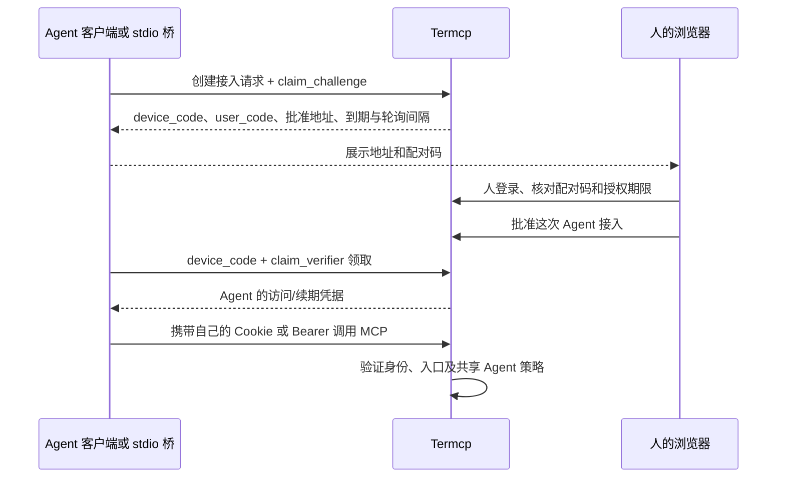

# 人与 Agent 的身份与凭据签发机制

状态：设计提案，未实现。日期：2026-10-27。源码核验基线：`dev@6a8af55`，另有未提交开发；本次只增加设计及交叉引用。

本文补齐 [Agent 权限设计](agent-permissions.md) 和 [权限过滤器实施方案](agent-access-implementation.md) 留出的身份签发部分。共享 Agent 业务策略、主机范围、MCP 入口限制及审批复核继续适用。所有新增路由、命令和数据结构均为提案。

按现有接入方式核验的交互见 [MCP 接入方式盘点与认证交互](mcp-access-auth.md)：3 类传输接入、4 种常用配置形态。最新决定为 **OAuth 整体先不实现，简易 token 为 P1**。Admin 由用户第一次运行时设置，配置及凭据当前明文持久化到默认 `.termcp` 下，后续配合加密系统；daemon 与 HTTP 模式读写同一套配置。本文保留的 OAuth、自定义配对、claim/renew 与 Agent Cookie 细节均属未来候选，不进入当前交付。

简易 token 的 stdio 读取与 P1 同批交付；HTTP/stdio OAuth 均延期。现有 daemon 按 endpoint 复用，本方案不额外新增启动锁或全机单例要求。多桥共享、权限持久化及待定项集中记录于 [协商与遗漏清单](stdio-daemon-negotiation.md)，讨论中的建议不自动成为已确认需求。

## 1. 设计结论

如果产品承诺区分 Admin 与 Agent，使用有身份管理的 managed 模式。当前先交付首次设置 Admin、配置/权限明文持久化与人端登录；P1 提供简易 Agent token：用户在 WebUI 新增 Agent，复制随机 token，自行配置到 MCP header/env，不要求自动配对、凭据库或自动换证。OAuth 整体移到未来，`open` 只保留为明确的本机兼容/开发选项。

角色始终来自服务端授权记录，客户端不能选择或修改。静态 token 和目标态的短期会话都引用独立 Agent grant；MCP 配置中的显示名称、`clientInfo` 或请求参数都不是身份。`open` 模式没有可信 Agent 身份，不能启用人/Agent 策略隔离，只适用于明确可信的 loopback 场景。

OAuth 的“客户端”特指实现授权能力的 MCP 宿主、SDK 或后续增强的 `termcp stdio` 桥，不是语言模型。首次领取和续期都由它主动发起请求并处理响应，不依赖服务端主动调用 Agent、向模型推送 Cookie 或修改宿主的 MCP 配置。简易静态 token 没有自动换证：MCP 宿主重启后重放同一 token 即可恢复；token 到期或撤销后需要人更新配置。

| 决策 | 使用体验 | 安全边界 |
| --- | --- | --- |
| Cookie 只保存 human 会话 | 浏览器自动携带，WebUI/WS 无须反复登录 | Agent 不使用 Cookie；长期登录密钥不进入 Cookie |
| 服务端保存角色和状态 | 无需在每次调用填写身份 | 改 Cookie 名、参数或 clientInfo 不能变成人 |
| Agent 接入先由人建立 grant | P1 在 WebUI 新增 Agent 并粘贴专属 token；未来可增加 OAuth 批准 | 每次接入有独立授权，可单独撤销和审计 |
| 静态 token 或短期访问凭据 + 有界续期 | 固定 header 兼容，或由 CredentialProvider 无感换证 | 静态泄漏窗口更长；轮换凭据不能延长授权绝对期限 |
| 人端 Cookie 与 Agent Bearer 映射到统一主体模型 | 浏览器和 MCP 客户端各走适合的凭据载体 | 角色由 Principal 决定，两种入口执行同一权限检查 |
| 高风险管理动作再次确认身份 | 日常终端使用不反复弹窗 | 批准长期接入、全局撤销等需要近期认证 |

第一版继续使用单个部署管理者的模型，不增加用户/组或逐 Agent 业务 ACL。每个 Agent 的 `grant_id` 只用于接入生命周期、审计和撤销，不能拿它选择不同业务权限。

### 1.1 客户端与服务端的硬边界

这里的“客户端”不能笼统地指 Agent。必须分开下面四个对象，否则会把模型调用、MCP 传输、HTTP 凭据管理和本地凭据持久化混成一件事：

| 对象 | 负责什么 | 不能负责什么 |
| --- | --- | --- |
| 模型 | 根据上下文调用已经提供给它的 MCP 工具 | 保存 Cookie/refresh token、完成浏览器授权、轮询认证端点或批准自己 |
| MCP 宿主/SDK | 启动 MCP 连接、向每个 HTTP 请求注入当前凭据，可选地实现 CredentialProvider | 在服务端不提供授权协议时猜测配对流程；代表所有静态配置客户端自动续期 |
| `termcp stdio` 等本地桥/凭据代理 | P1 读取静态 Agent env 并转发 Bearer；OAuth 登录、凭据保存和刷新为未来计划 | 绕开人的首次批准；在 stdio 的 MCP 消息流里伪造业务工具；替服务端修改宿主配置 |
| Termcp 服务端 | 当前验证首次设置的 Admin 凭据并加载持久权限；P1 允许 Admin 新增/撤销 Agent token；OAuth 授权服务为未来计划 | 主动连接一个尚未认证的 MCP 客户端、向模型推送 Cookie、更新宿主的静态配置文件或在客户端持久化 secret |

因此，**“自动配对”不是服务端可以单独提供的能力**。首次建立信任必须由宿主、桥或人参与，且只能有三种形式：

1. 支持标准 MCP HTTP 授权的宿主走 OAuth 授权服务器发现和浏览器授权流程。
2. 未来具备相关能力的 `termcp stdio` 或等价 CredentialProvider 可发起设备式配对，人批准，桥主动轮询领取；当前桥不实现这条路径。
3. 只能配置固定 header 的客户端由人一次性粘贴或配置 Agent 专属凭据；凭据过期后也必须由人重新配置。

没有以上任一执行者时，未认证客户端只能得到 `401`/`authorization_pending`，不能自助获得凭据。`clientInfo`、MCP transport session ID、namespace、loopback 来源和模型自述都不能替代人批准。

认证控制面与 MCP 业务面也必须分开。配对、claim、renew 和 logout 是精确注册的 HTTP 端点，不是未认证客户端可以调用的 MCP 工具：在认证完成前 MCP 传输本身就被拒绝；完成后再把“批准新接入”暴露给 Agent，则会让 Agent 有机会批准自己。现有 `notify_user` 只能在已有合法 grant 后通知人处理后续 HITL，不能承担首次配对。

单向通信不会阻断这套流程，因为它只要求一次 HTTP 请求及其响应，不要求服务端反向调用客户端。人批准后，服务端只修改 pending 状态；桥下一次主动轮询时在响应里取得凭据。MCP 的 SSE/stream 即使支持服务端消息，也不能在首次认证前建立合法业务 session，更不能替客户端更新 Cookie jar、环境变量或 MCP 配置。Cookie jar 同理只负责保存和回传 Cookie，不会自动调用 renew。

“重新获取”还要分成三个状态：

| 状态 | 谁触发 | 是否需要再次人工批准 |
| --- | --- | --- |
| 短期 access 凭据过期，refresh 仍有效 | 宿主或桥主动 `POST /auth/renew` | 否 |
| MCP 连接断开、模型上下文清空或桥进程重启 | 宿主/桥从凭据库恢复 refresh 后重连并 renew | 否，前提是授权仍有效且 refresh 未丢失 |
| grant 到期/撤销、refresh 丢失，或客户端只能携带固定 header | 重新创建接入；必要时由人修改配置 | 是 |

如果宿主既没有浏览器授权能力，也没有本地 CredentialProvider，服务端无法为其提供无人工介入的续期。此时只有两个诚实选择：使用 Termcp 桥，或明确降级为“到期后人工重新配置”。不能通过延长成永久 token、信任 loopback、按静态 client name 恢复授权或允许模型自批来掩盖这条边界。

### 1.2 P1 兼容版本：简易静态 MCP Token

对于只能保存固定 header/env 的简单 MCP 客户端，提供后续简易兼容版本：用户在 WebUI 新增 Agent，由服务端签发 **Agent 专属静态 token**，用户自行填入 MCP 注册配置，让每次 HTTP 请求携带 `Authorization: Bearer <token>`。不做自动派发、自动配置、配对或刷新，服务端在校验通过后把 token 映射成 `Actor{kind=agent, grant_id=...}`。

这要求 token 是服务端生成的至少 32 字节随机 secret，而不是用户随手选择的密码。服务端保存 lookup ID 和 secret 的 verifier、Agent grant、角色、标签、到期时间及撤销状态。MCP 配置只是凭据载体，不是身份声明；`clientInfo.name`、配置中的显示名称或请求里的 `agent_id` 都不能决定身份。每个 Agent 使用独立 token，才能独立审计和撤销；多个 Agent 共用一个 token 时，服务端无法区分它们。

部署级模式与凭据类型分开。OAuth 与 P1 Agent token 可以在同一 managed 实例共存，不再把二者设计成互斥的服务启动模式：

| 模式 | 行为 | 身份与适用边界 |
| --- | --- | --- |
| `managed` | 使用持久身份库；当前 Admin 登录，P1 增加 Agent 静态 token，未来可选 OAuth | 不同入口共用 Principal/Grant/权限判断 |
| `legacy-shared-token` | 显式保留现有部署级共享 token/hash 校验 | 迁移兼容；没有逐 Agent 身份，不能声称具备新的人/Agent 隔离 |
| `open` | MCP 不要求 token | 仅作为显式本机兼容/开发选项；请求没有可信 Agent 身份，不能启用人/Agent 隔离 |

“可以在注册时选择带 token”应理解为 managed 实例在 P1 支持显式 Agent token 凭据，不能理解成启用了认证后仍允许无 token 的请求执行同一组业务能力。请求级“带 token 就升级、不带 token 就匿名”的 fallback 会让攻击者直接省略 token，除非匿名身份另有真正更小且独立的权限集；Termcp 当前没有这样的匿名业务沙箱，因此不采用该模式。

静态 token 的日常流程是：

1. 人登录 Termcp，选择“创建 Agent 接入”，设置名称、期限和共享业务策略；Termcp 只显示一次新 token。
2. 人把 token 写入该 Agent 的 MCP 注册配置，优先通过宿主支持的环境变量或凭据引用注入；无法引用时，配置文件必须仅当前用户可读写。
3. Agent 重启、模型新建对话、MCP transport 重连或浏览器刷新都不改变身份，因为客户端继续发送同一个 token；服务端用持久化的 verifier 恢复 grant。
4. token 到期或被撤销后，Termcp 返回 `401`。人在人端签发替代 token，更新客户端配置并重启/重载 MCP 宿主。服务端不能替客户端修改这份配置。
5. 轮换时应允许新旧 token 短暂重叠，确认新配置可用后再撤销旧 token；不能把同一静态 token 设成永久有效来消除迁移操作。

静态 token 的优点是兼容性高、重启后无需再次配对；缺点是没有短期 bearer 的轮换窗口，一旦被复制，在撤销前都可重放。它必须和以下限制一起使用：独立 Agent grant、硬到期时间、立即撤销、服务端只存 verifier、日志和工具结果不返回 token、错误信息不回显 token、远端只走 HTTPS。需要无感轮换或更强泄露控制时，再升级到 5.3 节的 CredentialProvider/桥模式。

### 1.3 推荐的身份架构

为了同时满足当前 Admin/Agent 隔离和以后多用户、多 Agent，身份模型不能只有“当前提交的 token 是否匹配”。推荐从第一版就采用下面的最小主体模型，但只开放当前需要的角色和接口：

```text
Principal
  id                 稳定主体 ID；改名不改变身份
  kind               human | agent
  tenant_id          多租户/组织接缝；单用户版固定为默认租户
  status             active | disabled

RoleBinding
  principal_id
  role               admin | member；agent 不绑定 admin
  scope              当前为 instance，未来可收紧到租户/资源组

AgentGrant
  id
  principal_id       agent 主体
  owner_user_id      创建/负责该 Agent 的人
  policy_id          当前全部指向共享 Agent 策略
  expires_at, revoked_at

Credential
  id
  principal_id
  kind               human_session | human_api_token | agent_token | refresh
  secret_hash
  audience           当前只接受本实例
  expires_at, revoked_at, last_used_at
```

这里 **Admin 是 human Principal 上的角色，Agent 是另一种 Principal**，两者不是互斥但同层的“账号类型”。Agent 永远不能持有 Admin role；以后多用户时，每个用户是否 Admin 由 RoleBinding 决定，不需要复制一套认证系统。

共用身份流程及静态兼容分支：

1. 首次启动只允许 loopback 的本机 bootstrap，完成“创建首个 Admin”。完成后关闭 bootstrap，业务接口要求人端登录；同一 OS 用户仍属于部署管理边界，不能声称防本机恶意进程。
2. Admin 在 WebUI 登录，获得 HttpOnly human session Cookie；REST/WS 写操作校验 CSRF 和 Origin。Cookie 只供浏览器，不复制给 Agent。
3. OAuth 授权页由人批准创建或关联 Agent Principal/AgentGrant，宿主通过标准协议领取凭据。简单宿主使用后续 WebUI 新增 Agent 分支，Termcp 只显示一次高熵静态 token，以 verifier 持久化并映射到稳定 `principal_id + grant_id`。
4. Admin 只把该 Agent 的 token 配置到对应的 MCP 宿主或通过 `termcp stdio` 注入。不能把 Admin session、登录密钥或 Admin API token 配给 Agent。
5. 每次请求产生可信 `ActorContext{principal_id, actor_kind, roles, grant_id, auth_method}`。入口过滤器据此允许 Agent 只进入 MCP 业务面，允许 Admin 使用 WebUI/REST/WS 并管理 Agent；权限层不读取 `clientInfo`、namespace 或客户端自报 role。
6. Token 到期或撤销后返回 `401`。Admin 签发替代 token，新旧 token 可短暂重叠；同一 Agent Principal 可以拥有多枚轮换 token，但它们共享一个身份。

多用户和多 Agent 只需要扩展这张模型，不重写业务鉴权：

- 多用户：增加用户邀请/OIDC 等登录方式，给 human Principal 绑定 `admin` 或 `member`；认证会话继续指向 Principal。
- 多 Agent：每个 Agent 独立 Principal、Grant 和 token；资源可见性从 Admin 的 owner/tenant 与 AgentGrant 推导。
- 每个 Agent 独立策略：`AgentGrant.policy_id` 从共享 policy 指向个体 policy；有效权限只能收紧，不能突破部署限制。
- Agent 委派：以后增加 parent/child 关系时必须显式建模；不能让 Agent 自己创建更宽权限的 token 或另一个 Agent。
- 长期自动化：凭证中心/桥保存 refresh token 并自动 renew；纯静态 MCP 客户端仍使用可轮换的 agent token。

OAuth 整体留作未来计划，不要求当前实现发现、客户端注册、授权码/PKCE 或刷新。当前 Admin 及 P1 Agent token 共用身份库和权限判断，不能把 token 做成能绕过 AgentGrant 的另一套认证系统。

### 1.4 简易 token 兼容版本的接入向导

首期降低复杂度的目标是：**用户登录后创建一次 Agent，拿到现成 MCP 配置并粘贴，不再实现额外包装进程和第二次 token 兑换。** MCP 协议本身没有统一的配置占位符；宿主配置是否支持环境变量插值由具体客户端决定，因此 Termcp 应生成它实际能识别的配置，而不是假设 `${TOKEN}` 在所有客户端都有效。

WebUI 登录后提供“连接 Agent”向导：

1. 用户输入 Agent 名称，确认默认期限，点击“创建 Agent”。角色固定为 agent，默认使用共享 Agent 策略。
2. Termcp 创建 Agent Principal、AgentGrant 和一枚 opaque agent token；服务端只持久化 token 的 lookup ID 与 verifier。
3. 页面只显示一次原始 token，并同时生成可直接使用的 MCP 配置。用户不需要理解 `sse`、`stream`、`Bearer` 或 grant。
4. 用户选择“复制 HTTP 配置”“复制 stdio 配置”或“复制 Agent 安装提示词”。配置中可以直接包含 token；若该宿主明确支持环境变量引用，则生成带环境变量占位符的版本。
5. 安装后页面等待 Agent 的第一次认证 `initialize`。连接注册表绑定稳定 `principal_id` 后显示“已连接”，并提供一次只读 smoke test。

HTTP MCP 的首期配置可以就是：

```json
{
  "mcpServers": {
    "termcp": {
      "type": "http",
      "url": "http://127.0.0.1:18765/stream",
      "headers": {
        "Authorization": "Bearer <agent-token>"
      }
    }
  }
}
```

stdio MCP 使用客户端明确支持的环境字段：

```json
{
  "mcpServers": {
    "termcp": {
      "command": "npx",
      "args": ["-y", "@open-mcp-ai/termcp", "daemon", "stdio"],
      "env": {
        "TERMCP_AGENT_TOKEN": "<agent-token>"
      }
    }
  }
}
```

这里的关键是让桥和 HTTP server 共用同一个认证器：HTTP 模式从 `Authorization: Bearer` 取 token，stdio 模式从进程环境取 token 并转成同一 Bearer header；两者都解析成同一个 Agent Principal。客户端不支持环境变量插值时，向导直接填入字面 token，不能把一个不会被展开的 `${TOKEN}` 当成安全存储。

`TERMCP_AGENT_TOKEN` 是新增设计，尚未实现；不能用它替代服务端 Admin 初始化或自动登记新 Agent。上例适用于本机实例自动启动；连接已部署的远端服务应生成 `stdio <完整 URL>`。全新安装先用 `npx -y @open-mcp-ai/termcp daemon start` 启动并完成 WebUI 初始化，再复制带 token 的 MCP 配置，具体失败恢复和空闲期限见接入交互方案。

可以在 WebUI 中提供一段可复制的 Agent 安装提示词：

```text
只为 Termcp 增加下面这个 MCP server，完成后运行一次只读连接检查。
不要修改其他 MCP 配置或项目文件，也不要打印或回显 token。

<由 Termcp 生成的完整 mcp add 命令或 JSON 配置>
```

这条路径需要目标 Agent 有 shell 工具和修改自身 MCP 配置的权限。提示词中包含的 token 可能进入聊天记录，这是用户主动选择的便利性折中；因此 token 必须有明确到期时间、可立即撤销，并通过 token ID 审计。只通过 Termcp MCP 工具连接、没有 shell 的 Agent 无法自行修改宿主配置，只能由人粘贴配置。

建议的首期用户步骤只保留：

```text
登录 Termcp
创建 Agent
复制现成 MCP 配置或安装提示词
等待“已连接”
```

额外的系统凭据库、`termcp agent run` 包装器、一次性 enrollment code 和自动轮换都移到后续增强，不作为首期阻塞项。它们适合高安全部署或支持 CredentialProvider 的宿主，不应成为普通用户接通 MCP 的前置条件。

服务端通过认证后的 `Mcp-Session-Id` 关联 Principal 来观察首次连接，不把 `clientInfo` 当成身份；自动识别宿主失败时只影响生成的配置类型，不影响 Agent 身份。Token 不放进 URL query、普通日志或 MCP 工具结果。

### 1.5 简易 token 兼容版本的配置生成

不存在一份能直接覆盖所有 MCP 宿主的认证配置。兼容层应先生成统一的 `AgentRegistration`，再按客户端能力渲染，而不是让认证逻辑知道 Claude、Codex、VS Code 等配置格式：

```text
AgentRegistration
  server_name
  principal_id
  agent_token
  endpoint
  preferred_transport   stdio | streamable_http | sse
  client_kind           known ID or generic
  target_scope          user | project
  host_platform         darwin | linux | windows | remote
```

服务端只负责生成一次 `AgentRegistration` 和 token；渲染器是纯函数，输入注册描述，输出一种安装产物：

| 层级 | 产物 | 适用客户端 | 实现优先级 |
| --- | --- | --- | --- |
| 1 | 宿主官方 `mcp add` 命令 | 已适配且安装在本机的客户端 | 首选；调用客户端自己的配置逻辑，避免猜文件格式 |
| 2 | 官方配置文件 JSON/TOML 片段 | 已知配置结构的客户端 | 次选；只生成片段，首版不直接改用户文件 |
| 3 | 通用 stdio 配置 | 能启动本地进程并支持 env 的客户端 | 通用兜底；token 放入 env 字段，由 `termcp stdio` 转成 Bearer |
| 4 | 远程 Agent 安装提示词 | 有 shell 和配置写权限的 Agent | 让 Agent 按提示词调用 Termcp CLI 或写自己的配置 |
| 5 | “不支持认证直连”说明 | 只接受 URL、既无 header 又无 env 的客户端 | 不把 token 放 URL；要求改用 stdio、宿主升级或后续 OAuth |

已知客户端通过一个能力表驱动，不为每个客户端复制认证逻辑：

| 客户端类别 | 注册方式 | Token 载体 |
| --- | --- | --- |
| Codex | `codex mcp add`，HTTP 可用 `--bearer-token-env-var` | 环境变量 |
| Claude Code | `claude mcp add`，HTTP 使用 bearer header | header 或客户端支持的 env 引用 |
| Gemini CLI / Crush 等 CLI | 各自官方 `mcp add` 命令或命令名列表 | 优先 env，必要时字面 header |
| Claude Desktop / Cursor 类 JSON | `mcpServers` 配置片段 | `env` 或 `headers` |
| VS Code / Copilot | `servers` 配置片段 | `env` 或 `headers` |
| opencode | `mcp` 配置片段，command 为 argv 数组 | 客户端支持的 env |
| 未知客户端 | “让 Agent 安装”提示词 | 提示词中的完整命令或配置 |

渲染器应声明自己的能力而不是用客户端名字散落判断：

```text
ClientAdapter
  id
  Detect() capabilities
  Render(AgentRegistration) Artifact
  Verify() connect result

capabilities
  transports             stdio | streamable_http | sse
  supports_headers
  supports_env
  supports_config_files
  supports_official_add_command
  recognized_token_placeholder
```

首版 UI 只负责选择和复制，不直接写第三方配置。这样无需为未知客户端维护文件路径、JSON 合并、原子写、备份、权限和客户端升级迁移；用户拿到已经填好的官方命令或配置即可。后续再为高价值客户端增加“自动写入”按钮，调用其官方 CLI 或安全的配置编辑器。

客户端识别按以下顺序进行：

1. 用户从已知列表选择客户端，或本机检测到可执行文件和已知配置路径。
2. 使用该客户端明确支持的最高兼容方式：官方 CLI → HTTP Bearer → stdio env → 安装提示词。
3. 若用户直接粘贴了一个未知客户端的配置要求，只生成抽象描述，不猜测 `${TOKEN}` 会被展开。
4. 安装成功后由服务端连接状态确认；配置文件写入成功不等于 MCP 连接成功。

“兼容所有 Agent”的可验证定义是：

- 支持 stdio 与 env：可以接入。
- 支持 HTTP/SSE 与自定义 Authorization header：可以接入。
- 支持官方 `mcp add` 且能把 token 放进 env/header：可以接入。
- 能执行 shell 和编辑自身配置：可以由提示词引导接入。
- 只接受 URL、没有自定义 header/env，也没有 OAuth：无法安全接入；明确说明而不是把 token 塞进 URL。

这套分层把兼容工作限制在少量声明式 adapter 中；认证、权限和会话绑定始终走同一套 Principal 逻辑。新客户端不能通过声明一个配置格式绕过入口过滤或改变 Agent 角色。

创建 Agent 的响应可以一次返回所有首期安装产物，但必须使用 `Cache-Control: no-store`，且原始 token 只出现在这一次响应中：

```json
{
  "agent": {
    "id": "agt_...",
    "name": "coding-agent"
  },
  "token": "<shown-once>",
  "install": {
    "recommended": "codex",
    "codex_command": "codex mcp add ...",
    "claude_command": "claude mcp add ...",
    "stdio_config": {},
    "http_config": {},
    "agent_prompt": "..."
  }
}
```

用户关闭页面后不能再次读取原 token；token 丢失或怀疑泄露时创建替代 token，并撤销旧 token。服务端识别的是数据库中的 `principal_id + token_id`，客户端显示名只用于界面。

### 1.6 未来 OAuth 与 P1 简易 token 的共同边界

本节的 OAuth 流程只保留设计接缝，当前不实现；P1 token 不依赖它。

支持 OAuth 的宿主添加 Termcp URL 后，通过标准授权发现进入浏览器批准流程，用户不需要先新增静态 token。批准页确认 Agent 名称和策略后创建或明确关联 Principal/Grant；宿主用授权码与 PKCE 换取 access token，若获准获得 refresh token，则保存并主动刷新。Admin 是批准者，最终 MCP 请求只具有 Agent 执行权限。

OAuth `client_id` 标识应用，不代替 Agent ID。每个获批接入关联稳定 Agent/Grant，刷新不改变身份，撤销在共用权限层生效。标准 OAuth token endpoint 与可选自定义 `claim`/`renew` 不混用；静态 token 不能拿到 OAuth token endpoint 换取长期 refresh。

简易兼容版本最小 UI 为“新增 Agent → 一次显示 token → 用户自行填入 MCP 配置”，再提供名称/状态/最近使用、撤销，以及在原 Agent 下重新生成 token 的操作。无需为了这个版本实现自动配置、Agent 自助注册、自动轮换或额外包装进程。HTTP 直接填写 Bearer，stdio 填写桥读取的 env；客户端重载由用户负责。

OAuth 的规范依据为 [MCP HTTP 授权](https://modelcontextprotocol.io/specification/2026-07-28/basic/authorization) 与 [安全要求](https://modelcontextprotocol.io/specification/2026-07-28/basic/authorization/security-considerations)。stdio OAuth 客户端及本机 HTTPS/回调部署需要单独适配，不假定所有宿主都支持。

## 2. 已核验的当前行为

| 源码位置 | 当前行为 | 本方案的变化 |
| --- | --- | --- |
| `internal/auth/auth.go:125`，`Verifier.Verify` | hash 配置既接受原 token，也接受 hash 字符串本身 | 新模式只把 hash 作为校验材料，不能直接登录 |
| `internal/auth/auth.go:151`，`credentials` | 将 Authorization 和 Cookie 都列为候选 | 显式 Authorization 失败就返回 401，不降级到 Cookie |
| `internal/auth/auth.go:202`，`Middleware` | Basic 成功后把原凭据写入 `termcp_token`；无服务端会话到期/撤销表 | 登录接口签发随机会话，业务中间件只验证会话 |
| `main.go`，`runServer` | 一层认证包住 MCP、REST、WebUI、WS；没配置认证时可不安装中间件 | 新模式始终安装身份与访问面过滤器 |
| `internal/webui/ws.go:60`，`uiUpgrader` | `CheckOrigin` 返回 true | 校验可信外部 origin，绑定会话并执行连接撤销 |
| `internal/mcp/origin.go:23/51` | forwarded 信息用于展示 origin，组合 MCP 请求上下文 | 保留展示用途；另建安全 origin 校验并传递可信 Actor |
| `internal/daemon/daemon.go:90`，`Credential` | daemon 与 stdio 可直接复用配置 token/hash | 新模式拆分人端管理与 Agent 接入凭据 |
| `internal/mcpbridge/bridge.go`，`authorize` | 向上游注入固定 Bearer/headers | 首期读取独立 Agent token；后续再增加凭据提供器和按需续期 |

按当前基线，Termcp 的 MCP HTTP 面只有固定的 Bearer/Basic/Cookie 校验：没有 `WWW-Authenticate: Bearer resource_metadata=...`、授权服务器发现、配对、claim 或 renew 端点；stdio 桥也只是“逐行转发 MCP 消息并附加固定 header”的中继。现在能够自动做到的只有 MCP JSON-RPC 层的初始化和传输重连；凭据首次获取和到期恢复仍由人手动配置，不能把当前实现描述成已经支持自动配对或自动续期。

早期核验时图谱没有本项目索引，采用定点源码阅读。接入方式细化时已建立索引、核对调用链及依赖路径 coverage；npm 包装器被排除的启动段直接读源确认。核验范围见接入交互方案，并非全项目安全审计。

## 3. 信任模型与角色

服务端验证成功后产生 `Actor { kind, grant_id, session_id, auth_time }`，其中 `kind` 只有 human 或 agent；未知状态拒绝业务访问。这里的 `session_id` 是认证会话 ID，与 Termcp 的终端 session ID、MCP transport session ID 分开命名和存储。

| 对象 | 它证明什么 | 它不能做什么 |
| --- | --- | --- |
| 部署登录密钥 | 持有者能以管理者登录 | 不能直接当业务 Cookie/Bearer 使用 |
| 人端会话 | 某次成功登录获得的 human 接入 | 不能自动转交给 Agent |
| Agent 接入授权（grant） | 人已批准这次 Agent 接入和期限 | 不覆盖共享策略、不获得管理能力 |
| 访问凭据 | 引用某个有效授权的短期会话 | 不能靠自述角色扩大权限 |
| 续期凭据 | 在固定期限内换取同角色的新访问凭据 | 不能调用业务、不能改变角色、不能签发子授权 |
| 配对码 | 帮人找到待批准请求 | 单独持有它不能领取凭据 |

`actor_kind` 的含义是“这份接入凭据被授予了哪种角色”，不是检测请求背后是人还是程序。Agent 一旦拿到人的密钥、Cookie 或已登录浏览器控制权，就能够使用人的授权。本方案通过独立 jar、避免密钥下发和入口限制减少误用，不能证明操作者的生物身份，也不隔离同一 OS 账号下的恶意进程。

### 3.1 Bearer token 同时承载准入和身份引用

Agent 使用 `Authorization: Bearer <token>` 是合适的：bearer token 天然表示“持有者可以访问”，并且客户端无需 Cookie、浏览器跳转或额外协商。这里可以做到一次认证同时得到准入和身份，但正确的语义链必须是：

```text
raw token
  -> credential lookup
  -> credential.status / audience / expiry
  -> principal_id
  -> actor_kind + roles + AgentGrant
  -> current policy and resource checks
```

因此：

- token 是**认证凭据**，`principal_id` 才是稳定身份。
- token 可以用来找身份，但 token 文本本身不是身份 ID，不能直接作为用户名、资源 owner 或审计主体。
- 权限不写死在 token 中。每次请求仍从当前 AgentGrant、角色和策略解析；修改策略或撤销 grant 后，同一 token 的下一次请求立即使用新结果。
- 同一 Agent 可以轮换多枚 token，新旧 token 都引用同一个 `principal_id`；停用旧 token 只撤销对应凭据，不改变 Agent 身份。
- 要区分两个 Agent，必须签发两枚引用不同 Principal 的 token。共享 token 只能得到一个共享 Agent 身份。
- 服务端只持久化 token verifier，并记录 token ID、所属 Principal、audience、签发者、到期与撤销时间。日志和审计使用 token ID 或 Principal ID，不记录原始 token。

Agent 的 MCP transport session 在 `initialize` 时也要绑定认证得到的 `principal_id` 和 token 所属 grant。后续同一 `Mcp-Session-Id` 的请求如果换成另一个 Principal 的 token，必须拒绝，不能只看“两个 token 都有效”。

这样 token 可以同时承担日常使用中的“准入”和“我是谁”，但授权结果仍由服务端主体记录和实时策略产生。静态 bearer token 被盗后在到期或撤销前可重放，因此每 Agent 独立、高熵、可撤销、有绝对期限是使用它的前提。

## 4. 人的登录和首次建立信任

### 4.1 正常登录

1. 打开 `/login`。登录页及最小静态资源公开，不含业务数据；公开 `/api.md` 的规则保留。
2. 页面获取受限的预登录会话和 CSRF challenge，用户输入首次设置的 Admin 账号和密码。
3. `POST /auth/human/login` 验证持久化的 Admin 凭据、预登录 challenge、来源与速率限制。请求体和请求头不写日志；登录成功后销毁预登录状态并签发 human 会话；短期访问/续期双凭据属于后文候选方案，不作为本阶段必需实现。
4. 服务端通过 `Set-Cookie` 交付凭据。JSON 只返回角色、到期时间、CSRF token 等安全元数据，不回显 Cookie 或登录密钥。
5. 页面返回登录前目标；返回地址只接受本站相对路径，拒绝协议、双斜线或跨站重定向。

新模式不在业务接口发 Basic challenge，避免浏览器缓存的长期 Authorization 影响退出或覆盖 Agent 身份。管理者的 CLI 若需要人端操作，也走登录换会话，凭据通过无回显输入或受保护句柄传入，不放命令行参数。

### 4.2 首次安装与找回

用户第一次运行程序时设置 Admin 账号和密码。当前按已确认需求，将 Admin 配置及凭据明文保存到数据目录，默认 `.termcp`；正常启动直接读取，后续再配合项目加密系统迁移。当前不强制系统凭据库、随机登录密钥、密码 KDF 或独立本机管理通道。

HTTP 和 daemon 使用同一份落地配置与权限记录，不按启动方式创建两套 Admin。首次设置成功后关闭初始化入口；配置损坏或读取失败不能自动重新初始化。stdio 的 stdin 只承载 MCP，不能在该通道读取设置密码；首次设置须通过用户可见的入口完成。

旧共享认证保留显式迁移路径，不能把旧 token/hash 自动当作新 Admin 身份。`termcp auth init/setup/recover`、专用 socket/named pipe 和密码加密均留作后续候选，不作为本阶段前置要求。找回或迁移须由部署管理者显式执行，不因请求来自 loopback 或启动过 daemon 就授予 Admin。

## 5. 可选后续：自定义 Agent 配对与签发

### 5.1 支持主动领取的客户端流程

本节保留为可选方案，需要额外客户端能力，不是 OAuth 或静态 token 的必需步骤。OAuth 使用标准授权码/PKCE 和 token endpoint，不能照搬本节 claim/renew 作为标准授权。静态兼容版本由 Admin 创建 Agent，再人工填写 header/env；已有 stdio 桥不会因为能发 HTTP 请求就自动具备配对功能。

借鉴设备授权流程，将“人批准”和“Agent 领取”分开；不是声明实现完整 OAuth 授权服务器。设备流程的短码、轮询和钓鱼风险见 [RFC 8628](https://www.rfc-editor.org/rfc/rfc8628.html)。



具体约束：

1. 客户端生成随机 `claim_verifier`，只发送其 SHA-256 challenge 创建请求；服务端硬编码目标角色为 agent。拒绝请求中的 role、人端 scope 或自选签发者字段。
2. 服务端生成 256 位随机 `device_code` 和 8 位易读 Base32 `user_code`；后者仅用于核对。请求 5 分钟到期，默认每 5 秒轮询，超频响应 `slow_down` 并增加间隔。
3. 人打开本站批准页并登录，核对 Agent 显示的码。页面显示“授予 Agent 接入”、共享策略摘要、任务期限和来源提示；客户端自报名称标为自述，不能显示为已验证身份。单纯打开链接或带码 GET 不产生批准。
4. “批准本次任务”为主选项；“记住此接入”是明确的第二选择，受部署允许的最长寿命约束。人可缩短期限，不能越过部署上限。批准长期接入需要 5 分钟内重新确认过身份。
5. 审批只更新服务端 pending 状态。人的浏览器不接收 Agent Cookie，批准响应不返回领取密钥。Agent 用 `device_code + claim_verifier` 从自己的连接领取；challenge 不匹配就拒绝。
6. 领取在事务中将 pending 变成 claimed，只产生一个 grant。Cookie 模式只用 `Set-Cookie`；Bearer 模式在响应体返回访问凭据与续期凭据，禁止两个模式同时交付。首次领取的网络重试采用第 8 节相同的有界幂等规则。
7. 在等待批准时只输出配对地址和码。stdio 的提示走 stderr 或宿主交互，stdout 保持 MCP 协议；无需调用已受保护的业务通知工具才能完成首次接入。

配对地址使用配置的可信外部 origin，不能根据任意 Host/forwarded 头生成。地址中只允许放用于显示的短码，不放 device_code、claim_verifier 或访问凭据。人应从自己的已知 Termcp 地址进入并核对码；自动打开的页面也必须明确批准，避免把设备流程变成点击即授权。

### 5.2 持续自动化与无浏览器客户端

被明确记住的接入由桥或 SDK 保存续期凭据，模型只见到非敏感的接入 ID。优先使用系统凭据库；不可用时允许部署明确选择受限权限的用户数据目录文件，Unix 文件 0600/目录 0700，Windows 使用当前身份 ACL。不能把续期凭据写入仓库、普通 MCP 配置 JSON、环境样例或工具结果。

支持 Cookie 且能主动续期的 HTTP 客户端使用专属 jar；只支持 Bearer 的 MCP 客户端由凭据提供器或 `termcp stdio` 桥注入同一种短期访问凭据。只配置固定 Cookie/header、不会处理换证的第三方客户端，不支持直接获得自动续期能力，应配置本地 stdio 桥；临时直连凭据到期后需要人工重新配置，不能描述为无感接入。不为兼容而发永久 token。无人值守任务由人预先完成一次配对并选择期限，不默认开启匿名 Agent 自助批准。

本期不实现 Agent 派生其他 Agent 凭据、用户/组、或本机进程自动被识别为可信 Agent。授权记录给后续签发链预留 `approved_by`，当前 Agent 没有签发权限。

### 5.3 单向通信下如何领取和换证

允许的通信拓扑只需要客户端能请求服务端并读取响应：

```text
语言模型 ──MCP 调用──> 宿主 / stdio 桥 ──HTTP 请求──> Termcp
                              <──原请求的响应───────
```

人点击批准后，服务端仅将 pending 标为 approved；桥下一次主动轮询 `POST /auth/agent/claim` 时，在该请求的响应中领取凭据。批准页面不需要反向连接 Agent，也不负责替 Agent 更新配置。未批准只返回 `authorization_pending`，拒绝/过期则停止轮询。这个方向约束与 [RFC 8628 第 3.5 节](https://www.rfc-editor.org/rfc/rfc8628.html#section-3.5) 描述的单向设备流程一致。

访问凭据即将到期时，CredentialProvider 使用自己保存的续期凭据主动请求 `POST /auth/renew`，消费响应里的新 Cookie/Bearer 并原子更新自身存储；下一次 MCP 请求携带新值。这个步骤由宿主代码执行，不需要模型生成一次工具调用，也不需要人再次批准。HTTP Cookie jar 只负责保存/携带 Set-Cookie，并不会自行发起 renew，不能把“用了 Cookie”当作“实现了自动刷新”。

在 MCP 业务连接尚未认证或已经过期时，桥仍能直接请求第 11 节的精确认证控制端点；它们按 device proof 或 refresh proof 校验，不能要求先有有效的 MCP 访问会话。请求来自桥自己的 HTTP 客户端，不借用 Agent 尚不可用的业务工具。配对等待有截止时间，并能被取消；不得永久阻塞宿主初始化，宿主可显式显示“等待授权”或返回可重试的接入错误。

| 所谓“刷新/重启” | 恢复方式 |
| --- | --- |
| 15 分钟访问凭据到期 | provider 主动 renew，读取响应，无人工动作 |
| 模型上下文清空或新建对话，桥仍在 | 继续使用桥保存的授权，不依赖模型记住 Cookie |
| 桥进程重启，已选择记住接入 | 从凭据库恢复续期凭据，再主动 renew；授权仍有效则不再批准 |
| 桥进程重启，本次任务凭据仅在内存 | 凭据已丢失，重新配对；不能靠名称找回原授权 |
| 授权绝对到期、空闲过期、被撤销或续期凭据丢失 | 重新建立授权；不能从匿名请求自动恢复 |
| 只有固定 header 的 MCP 直连配置 | 不会自动换证，改用桥或支持 CredentialProvider 的宿主 |

如果运行环境连客户端主动请求认证端点、保存状态和消费换证响应都不允许，则本节的自定义短期轮换不能在该环境无感工作。P1 简易 token 专门兼容这种客户端，承担更长的凭据重放窗口，不等价于自动轮换，也不能用人的 Cookie 替代。由桥管理短期凭据的方案属于未来计划，当前不实现。

## 6. 凭据、Cookie 和验证规则

### 6.1 随机不透明凭据

访问凭据采用 `tcs1.<lookup_id>.<secret>`；续期凭据使用不同类型前缀 `tcr1`。lookup ID 随机且仅用于索引，secret 至少 32 个 CSPRNG 字节，Base64URL 编码。服务端持久化完整 secret 的 SHA-256 verifier，并做恒定时间比较；不能只校验 lookup ID，不能把保存的 verifier 作为可接受凭据。

角色、grant、到期、签发者和吊销状态全部查服务端记录。第一版不用 JWT，避免为角色变化、即时撤销和密钥轮换引入第二套状态模型。随机凭据与散列存储的依据见 [OWASP 会话管理指南](https://cheatsheetseries.owasp.org/cheatsheets/Session_Management_Cheat_Sheet.html#server-side-session-token-storage)。

### 6.2 Cookie 属性

TLS 部署统一使用：

```http
Set-Cookie: __Host-termcp_session=<opaque>; Path=/; Secure; HttpOnly; SameSite=Lax
Set-Cookie: __Host-termcp_refresh=<opaque>; Path=/; Secure; HttpOnly; SameSite=Lax
```

两者都不设置 Domain，业务入口只验证访问 Cookie，续期 Cookie 只在认证接口中消费。统一 Path 是为采用 `__Host-` 约束；不能把 Cookie Path 当权限隔离。默认不记住登录时使用 session cookies；选择记住后才加 Max-Age，且不超过剩余授权期限。即使浏览器恢复 session cookie，服务端到期时间仍是硬限制。

选择 `Lax` 方便从外部链接打开 WebUI；所有业务 GET/HEAD 必须无业务副作用，写操作和 WS 另外检查 CSRF/Origin。`SameSite` 只作附加保护；[OWASP CSRF 指南](https://cheatsheetseries.owasp.org/cheatsheets/Cross-Site_Request_Forgery_Prevention_Cheat_Sheet.html#samesite-cookie-attribute) 说明了其同站子域与安全方法限制。

HTTP loopback 的本机模式使用不带前缀的 `termcp_session` / `termcp_refresh` 并省略 Secure，不依赖浏览器的 localhost 特例。仅当**实际连接和 Host 都符合配置的 loopback origin**时允许；非 loopback 必须经 HTTPS，包括远程 Agent 的认证。TLS 与本机 HTTP 模式各只接受自己的一组名称，不在两组间降级。

Cookie 不按端口隔离；同一 hostname 上的其他服务可能收到 Cookie。远程部署应给 Termcp 独立 hostname；本机 HTTP 模式只适用于可信本机服务环境，不声称隔离其他本地端口。

### 6.3 明确的载体选择

| 请求携带的内容 | 行为 |
| --- | --- |
| 一个有效 Authorization Bearer | 只按 Bearer 认证，忽略附带 Cookie，角色来自该凭据 |
| Authorization 存在但无效、未知 scheme 或重复 | 返回 401/无效请求，绝不回退 Cookie |
| 没有 Authorization，携带一个有效访问 Cookie | 按 Cookie 认证 |
| 同名访问/续期 Cookie 重复或格式不合法 | 拒绝，避免 Path/Domain 叠加产生不同解析结果 |
| 只有续期 Cookie 访问业务接口 | 401；客户端先续期 |
| 任一角色访问不获准的 surface | 403；不尝试另一种角色或凭据 |
| 旧 `termcp_token`、Basic、登录密钥或其 hash 用于新模式业务接口 | 拒绝 |

首期 Cookie 只用于 human，Agent 仅接收 Bearer；Agent 自动化不得复用人的已登录 profile，桥不导入浏览器 Cookie。若后续实验启用第 5 节的 Agent Cookie 交付，必须使用独立 jar，不能与 human Cookie 混用。客户端不得跨 origin 转发 Authorization 或 jar；遇到重定向终止认证请求，不跟随到其他站点。

## 7. 自定义短期会话的默认期限与交互

以下数值用于自定义短期会话的候选方案，不是已决定的 OAuth 默认值，也不用于静态 header/env token。OAuth 的 access/refresh 期限由其授权服务配置，静态兼容版本由创建向导设置凭据期限、到期后人工替换。以下数值是产品默认提案，不是协议要求。上限可以由人缩短；客户端不能自行延长。

| 授权类型 | 访问凭据绝对有效期 | 授权空闲期限 | 授权绝对期限 | 续期凭据保存 |
| --- | --- | --- | --- | --- |
| 人正常登录 | 15 分钟 | 8 小时 | 24 小时 | session cookie |
| 人勾选“记住登录” | 15 分钟 | 7 天 | 30 天 | 持久 Cookie |
| Agent 本次任务（默认） | 15 分钟 | 1 小时 | 8 小时 | 进程内 jar/内存 |
| 人明确“记住此接入” | 15 分钟 | 7 天 | 30 天 | 专属凭据库/jar |
| 人端敏感管理确认 | 沿用访问凭据 | — | 确认后 5 分钟 | 仅服务端 `auth_time` |

“空闲”只由已获准的实际业务活动更新；轮询、renew、心跳、被拒绝的请求、空连接以及仅接收服务器广播不续租。人的终端键入、显式查询等更新活动；后台页面存活本身不让授权永久有效。服务器写 `last_activity` 可节流，但判断使用单进程内的实时值。

访问到期前由 WebUI/桥统一调用 renew，续期不会更新 `auth_time`，也不重置 grant 的绝对期限。临近授权期限在人端显示提示，Agent 得到结构化到期信息；任务授权已到期则必须重新获批，不能把循环续期变成永久接入。

## 8. 续期、并发和退出

### 8.1 自定义续期候选：受限换证

renew 校验 grant 未被撤销、未超过空闲或绝对期限，并以事务 CAS 消耗当前 refresh generation，签发下一代续期凭据及新的短期访问凭据。role、授权来源和绝对到期保持不变，策略每次执行时仍取当前值。续期 token 轮换与重用检测参考 [RFC 9700 第 4.14 节](https://www.rfc-editor.org/rfc/rfc9700.html#section-4.14)；本方案使用自己的会话协议。

客户端用一个共享续期任务合并并发请求；WebUI 跨 tab 协调，桥使用互斥锁。每次 renew 附带随机 `renewal_nonce`，一次请求的网络重试使用同一个 nonce。

为兼顾网络丢包与重放检测，定义固定的 30 秒幂等窗口：

- 相同旧凭据 + 相同 nonce：只返回已完成的同一结果，不能再次延长期限；返回前确认 grant 仍有效且结果仍是当前 generation，否则拒绝，不把 Cookie 回滚到旧代。短期响应缓存仅在服务端内存保存，不持久化原始 secret。
- 同一旧凭据 + 不同 nonce：窗口内返回 409 `renewal_conflict`，不发凭据、不清 Cookie；客户端等待成功的续期任务更新 jar 后使用新一代，不盲目重试旧值。WebUI 由浏览器携带 HttpOnly Cookie，JS 不读取 secret。
- 超过窗口再使用已消费凭据：撤销整份 grant 及其访问会话，要求重新登录/配对。不存在任意旧 generation 的通用宽限。
- 事务已提交但服务重启导致幂等缓存丢失：返回 `reauth_required`，不重新生成第二个结果；该分支可牺牲一次便利性，不能重复签发。

普通 renew 后，并发中的旧访问凭据可用到自己的 15 分钟到期，整份 grant 撤销时一起失效。成功重新确认身份属于例外：原子地轮换该 grant 的访问和续期凭据、失效之前全部访问会话和 refresh generations，再更新 `auth_time`，避免旧会话享受新近认证状态。登录和重设登录密钥也必须生成新会话，不能只修改客户端提供的 session ID。两个角色都不使用能无限滚动的永久 Cookie。

### 8.2 静态 Agent token 的派发和轮换

静态 MCP token 与短期 access token 不同：服务端无法把新 token 主动写入远端 MCP 配置。首期默认不执行周期性自动轮换，而是签发有明确到期时间、可立即撤销的静态 Agent token；需要时由 Admin 手动轮换。这样普通用户只需完成一次 MCP 配置，不会每隔几天重新接线。

首次派发有三条路径：

| 场景 | 派发方式 | 人工步骤 |
| --- | --- | --- |
| Admin 与 MCP 宿主在同一台机器 | WebUI 生成完整配置或调用宿主官方 `mcp add` 的命令 | 复制一条命令或点击已支持的“自动配置” |
| 远程 Agent 有 shell 和配置写权限 | WebUI 生成包含完整配置的安装提示词 | 用户把提示词发给 Agent，由 Agent 写入自己的配置 |
| 只能通过管理界面静态配置 | WebUI 生成 HTTP/stdio 配置片段 | 用户粘贴到客户端配置并重启/重载 |

token 不会通过已经建立的 MCP 工具调用派发。首次调用前还没有合法 MCP 身份；把新 token 或轮换能力暴露成普通业务工具，会让被盗的 token 延长自己的访问期限。派发发生在认证控制面和配置管理面。

手动轮换采用双 token 重叠流程：

1. Admin 为同一 Agent Principal 创建下一代 token，新 token 与原 token 暂时都属于同一个 `principal_id`。
2. WebUI 使用新 token 重新生成配置或安装提示词。用户/Agent 更新配置并重启或重载 MCP 宿主。
3. 服务端记录每枚 token 的 `last_used_at` 和当前 MCP 连接。只有在看到新 token 成功 `initialize` 后，才把旧 token 标为“可撤销”。
4. 默认保留旧 token 一段时间处理传播、进程重启和未关闭连接；Admin 也可以选择立即撤销旧 token。
5. 撤销旧 token 后，以旧 token 建立的 MCP transport session 在下一次请求时失效，并应主动关闭。新 token 的身份仍是同一个 Agent，因此会话可重建，不需要重新批准 Agent。

状态建议为：

```text
pending_new  -> active_new
active_old   -> superseded_old -> revoked_old
active_old   -> revoked_old       (泄露或立即轮换)
```

如果只是 token 丢失，签发新 token 后可以直接撤销旧 token；如果怀疑泄露，不能等待新 token 首次连接，必须立即撤销。旧 token 被撤销后，其 `Mcp-Session-Id` 不能继续访问。

自动更新配置不属于静态 token 路径。要实现无人工轮换，客户端必须具备以下之一：

- MCP OAuth/refresh：客户端收到 `401` 后自行完成授权或续期。
- CredentialProvider：宿主主动调用 renew，保存新凭据并在后续请求中使用。
- `termcp stdio` 凭据代理：由本地进程轮换并更新请求，MCP 配置只需要引用稳定的本地命令。

静态 header 客户端不会因为服务端签发了新 token 就自行更新。这条边界必须直接展示给用户，不能用“自动轮换”误导。

### 8.3 退出与撤销

“退出本设备”撤销对应 grant 的全部访问/续期凭据，并清除两种 Cookie；仅删除浏览器 Cookie 不算退出。“退出所有人端设备”“撤销某个 Agent 接入”“撤销全部 Agent 接入”是独立动作。人的普通退出不默认中断已批准的 Agent 任务。

批准长期接入、撤销全部接入、重设登录密钥需要近期认证。重设密钥时默认撤销全部 human 和 agent grants 并递增部署认证 epoch；如果后续提供保留接入选项，必须作为明确的新设计评审。Agent 只能撤销自己的授权，不能查询其他接入或修改生命周期。

撤销按 grant 传递到活动连接：MCP SSE/stream、WS 注册 `grant_id + auth_session_id`，撤销事件立即取消连接；空闲/绝对到期也有定时器。每条客户端消息再次检查授权状态，不只在 Upgrade/初始化时校验。访问凭据到期时关闭其长期流，由客户端续期后重连；不能让无限 SSE 绕过到期。

人端 WebUI 可按会话机制续期并恢复自身订阅；OAuth HTTP 宿主按其客户端能力处理刷新和重连。stdio 的自动换证与透明恢复为未来计划，当前不实现，初版重连建议见协商讨论稿。连接换证本身不要求关闭终端进程；daemon 进程重启后的终端恢复另由业务生命周期规定。发送输入等非幂等业务请求不因认证重连自动重放，避免把一次命令执行两遍。

待审操作保存原 grant，审批回放时检查该授权仍有效，并重新执行现有权限设计的策略与资源复核。已发出的终端字节不能撤回；已开始的传输/任务不会凭认证撤销自动回滚。需要终止后台任务时由人显式操作，不能承诺原子撤销所有既成副作用。

## 9. CSRF、代理与接入防护

### 9.1 按实际载体检查

Cookie 自动随浏览器发送，因此人和 Agent 使用 Cookie 时都必须通过 CSRF 防护。预登录、登录、批准、renew、退出和业务写接口都使用绑定会话/grant 的同步 CSRF token。`GET /auth/context` 在验证访问或续期 Cookie 后返回该 token 和安全状态；不创建新授权，不延长生命周期，禁止缓存及跨站读取。续期不能依赖仍有效的访问 Cookie，否则访问到期后无法恢复。

业务写请求通过 `X-Termcp-CSRF` 携带 token；HTML 登录表单可使用隐藏字段。renew 在 Bearer 模式显式提交独立续期凭据，不从浏览器 Cookie 取隐式身份；此模式要求 JSON、自定义头，拒绝带 Origin 的跨站请求。CSRF token 不放 URL、不写日志、不当访问凭据使用。

写接口出现 Origin 时必须精确匹配；无 Origin 时校验 Referer 的精确 origin。二者都缺失时，仅接受通过自定义头携带有效同步 CSRF token 的客户端，缺少来源的普通表单拒绝。不能因 User-Agent 自称 CLI 放行。带显式 Bearer 的请求不依赖 Cookie，仍校验出现的 Origin、方法及权限。

WS Upgrade 必须匹配可信 origin，浏览器侧不接受 `Origin: null` 或缺失 Origin；凭据和短期 WS ticket 都不放 query。非浏览器 MCP Cookie POST 同样带 CSRF token。CORS 默认不向跨站开放 credentials；Fetch Metadata 作为附加检查，不作为唯一凭据。认证页面禁止被 iframe 嵌入。

### 9.2 可信 origin 与代理

新增一个安全用途的 canonical external origin 和可信代理配置，与现有展示用途的 `originFromRequest` 分开。直接连接取真实 TLS 状态并校验配置的 Host；只信任来自明确允许代理的 forwarded 信息，代理必须覆写客户端传入的同名头。不能仅因为 `X-Forwarded-Proto: https` 就发 Secure Cookie 或认为链路可信。

反向代理的 HTTP 上游只可被可信代理访问；公网客户端到代理使用 HTTPS。管理者更改 canonical origin 后旧来源的续期不接受，客户端重新接入。loopback 模式也检查 Host，避免 DNS rebinding 把任意域名解析到本机后使用管理接口。多实例不要共享认证库或 Cookie 主机名。

### 9.3 有界资源与日志

登录、预登录会话、创建配对、短码查询和轮询分别限速，既有单来源限制，也有全局预算，避免共享出口导致全站锁死或分布式请求绕过。初始建议：配对 pending 全局上限 100、每请求短码核对最多 5 次、5 分钟 TTL；达到上限返回 429，不挤掉已获批请求。IP 仅作风险信号，不绑定授权身份。

短码成功匹配也只进入确认页，不能凭短码领取；拒绝和过期都有明确终态。所有认证响应 `Cache-Control: no-store`，敏感页面使用 `Referrer-Policy: no-referrer`；日志统一屏蔽 Cookie、Set-Cookie、Authorization、登录表单、轮询领取体和认证响应体。

审计只记录时间、grant/session ID、角色、动作、批准者、结果和非敏感原因码；不默认收集 IP、User-Agent 原文或自报机器名。接入显示名称由人自定或系统生成，不自动采集 OS 用户名、hostname、邮箱。必要的网络来源提示只临时显示并脱敏，不写入项目文件或审计原文。

## 10. 服务端职责和数据

建议在 `internal/auth` 内拆清职责：

| 组件 | 职责 |
| --- | --- |
| LoginVerifier | 验证部署登录密钥，处理近期认证；不处理业务 Cookie |
| PairingService | pending/approve/deny/claim、短码限流和领取幂等 |
| SessionService | 随机凭据、验证、renew、logout/revoke、到期事件 |
| AuthStore | 认证数据事务、generation CAS、持久化撤销和 epoch |
| HTTP Adapter | Cookie/Bearer、CSRF/Origin、错误映射及可信 Actor |
| CredentialProvider | WebUI/桥的续期协调、专属 jar/凭据库 |

最少持久化以下数据，不复用终端会话存储对象：

```text
Grant:
  id, actor_kind, approved_by, auth_time, created_at
  idle_deadline, absolute_deadline, last_activity, epoch, revoked_at
  refresh_lookup_id, refresh_verifier, refresh_generation, delivery_mode

AccessSession:
  id, grant_id, secret_verifier, created_at, expires_at, revoked_at

ConsumedRefresh:
  lookup_id, grant_id, generation, verifier, consumed_at

PendingPairing (短期内存):
  id, device_verifier, user_code_verifier, claim_challenge
  expires_at, attempts, status, approved_by, approved_lifetime, claim_nonce
```

`delivery_mode` 为 cookie 或 bearer，绑定一次 grant，不能换载体时顺带换角色。ConsumedRefresh 保留至 grant 绝对到期后清理，用于验证旧凭据重用；只有 lookup_id 相同但 secret 不匹配不能触发撤销，避免靠公开 ID 制造拒绝服务。CSRF 材料由服务端随机生成并保护存储，不存可直接冒充访问者的 bearer 值。

当前配置及权限统一位于运行时 data-dir，默认 `.termcp`，Admin 凭据先明文持久化，未来再接加密。沿用现有 endpoint 实例复用，不为本认证方案额外引入启动锁或单例管理；保存成功后运行时及重启后须读取相同配置修订。角色、策略或撤销记录不可读/损坏时拒绝业务，不恢复全权。

后文若选用配对/refresh 候选方案，再实现具备事务的 Store 和 renewal CAS；当前不以这些未来能力要求先引入数据库或独占进程锁。认证库、备份和运行时真实凭据文件均不得进入 Git。

服务端每次业务请求查验 grant 的当前状态/epoch，不在 Cookie 固化策略副本。授权记录只携带“使用共享 Agent 策略”的关系；没有给单个 Agent 加 hosts/operations/vocabulary 覆盖。

## 11. 拟议路由与入口边界

当前先交付首次设置 Admin、明文配置及权限持久化、人端登录；P1 再交付简易 Agent token。OAuth 的资源发现、授权服务、客户端注册、authorize/token、PKCE 与刷新均为未来计划，不列入当前路由实现。

以下是后续静态兼容版本的管理路由，以及两种凭据共用的有限桥控制端点：

| 路由 | 可访问者 | 行为 |
| --- | --- | --- |
| `GET /auth/agents`、`POST /auth/agents` | Admin | 列表或创建 Agent；创建响应仅一次返回原始 token 和安装产物 |
| `GET /auth/agents/{id}/tokens` | Admin | 仅返回凭据 ID、期限、使用和撤销状态，不返回原始 token |
| `POST /auth/agents/{id}/tokens` | Admin | 为同一 Agent 创建替代 Credential，一次返回新配置 |
| `POST /auth/agents/{id}/tokens/{token_id}/revoke` | Admin | 撤销指定凭据并使对应活动连接失效 |
| `GET /auth/agent/bridge-context` | 有效 Agent Bearer | 只读的实例标识、协议、空闲期限及自身凭据期限 |
| `POST /auth/agent/presence` | 有效 Agent Bearer | MCP session 前的进程保活，不延长认证期限 |

Admin 写操作校验人端会话与 CSRF。多用户时再把管理范围按 owner/tenant 收紧；Agent 无权创建或替换自己的静态 token。以下保留自定义配对/claim/renew 候选路由，不作为 OAuth 的标准端点表，不要求主路径或简易兼容版本实现：

| 路由 | 可访问者 | 行为 |
| --- | --- | --- |
| `GET /login`、最小登录 assets、`GET /api.md` | 匿名 | 无业务数据 |
| `POST /auth/prelogin` | 匿名且同源 | 有界预登录会话与 challenge |
| `POST /auth/human/login` | 预登录状态 + 登录密钥 | 只能签发 human |
| `POST /auth/human/reauth` | human + 登录密钥 | 更新近期认证时间，轮换凭据并失效旧会话 |
| `POST /auth/agent/requests` | 匿名，限速 | 只能创建 agent pending |
| `GET /auth/agent/verify` | human | 查询短码、展示确认；GET 不批准 |
| `POST /auth/agent/requests/{id}/decision` | human + CSRF | 批准/拒绝，长期授权需近期认证 |
| `POST /auth/agent/claim` | device_code + claim_verifier | 领取已批准的 agent 凭据 |
| `GET /auth/context` | 当前访问或续期凭据 | 自身状态和 CSRF 材料，不续租 |
| `POST /auth/renew` | 当前续期凭据 | 固定角色换证 |
| `POST /auth/logout` | 自身有效访问或续期凭据 | 撤销本 grant，清 Cookie |
| `GET /auth/grants`、`POST /auth/grants/{id}/revoke` | human | 查看/撤销接入；全局动作需近期认证 |
| MCP 已注册确切路由和方法 | agent/human | 身份验证后继续业务授权 |
| WebUI、业务 REST、WS、daemon stop | human | agent 在 handler/Upgrade 前拒绝 |

Agent 的“只允许 MCP”是**业务访问面**；本表列出的自身 renew/context/logout 是有限的认证控制例外，不开放 `/api/*`，也不允许 Agent 查看批准队列、登录为 human 或修改策略。认证路由使用精确匹配和方法白名单，不能把整个 `/auth/*` 当公开路径。

MCP transport session 绑定 grant 和角色；每条消息的认证 grant 必须一致，不能只有角色相同就复用别人的 transport session。namespace、clientInfo、MCP session ID 和 loopback 均不能代替认证。

stdio 的 keepalive/探活也必须保持 agent 身份：目前桥握手前探测 `/api/daemon`，未建立 session 时还请求 `/api/version` 保活；不能继续携带人的凭据。首期改为上表精确的 bridge-context/presence 控制端点，不向宿主流中额外注入 initialize/ping；需要 daemon 详情和 stop 的人端 CLI 单独认证。不能为了让桥探活方便，把 `/api/daemon` 或所有 `/api/*` 全面放行给 Agent。

## 12. 迁移和交付顺序

旧模式和新模式通过明确配置切换，不能按一条请求是否带新 Cookie 自动选宽松认证。旧模式保留现有 token/hash/Basic 行为并标明没有人/Agent 隔离；新模式与 `DisableAuth` 不兼容，loopback 也不能省略身份。第一版不在同一个业务入口同时接受旧全权 token 和新 Agent 凭据，否则隔离可被旧密钥绕过。

当前交付顺序：

1. 共用基础：首次运行设置 Admin，明文配置及权限保存到默认 `.termcp`；HTTP/daemon 共用同一份状态，后续再接加密。
2. 业务权限：可信 Actor、权限过滤、MCP session 绑定及撤销；沿用既有 daemon Ensure 复用，不新增启动互斥模块。
3. **P1 简易 token**：WebUI 新增 Agent、一次显示随机 token、查看状态与撤销；同批实现 stdio 读取 token。用户自行填写 MCP header/env，人工重新生成后更新配置。
4. 桥与迁移：处理 Agent 探测/保活、重启后重新 initialize 和已发送操作不自动重放；旧共享凭据不能绕过新模式，不自动降级。
5. **未来 OAuth**：HTTP 授权服务、宿主兼容、stdio profile/浏览器授权/凭据保存/刷新均延期，当前不实现。

P1 token 不依赖自动配置、配对或刷新；OAuth 整体为未来计划，因此 P1 前不能宣称新 managed Agent 接入已完整可用。自定义设备配对、claim/renew 和 Agent Cookie 也是可选后续方案。当前不以 OAuth 的 HTTPS/issuer/refresh 等额外能力阻塞首次 Admin 设置和明文配置持久化。

## 13. 验收重点

这是后续实施所需的验收清单，本次文档变更没有修改或运行业务测试。

- 当前验收首次 Admin 设置、明文持久化及 HTTP/daemon 共用权限；P1 验收 Agent token 只能到达 MCP 和明确的桥控制端点。OAuth 的发现/PKCE/回调/resource/刷新及以下自定义配对/renew/Agent Cookie 项均在未来选用时验收。
- 修改角色参数、使用旧 Cookie、发送错误 Authorization + 有效 human Cookie、混用重复 Cookie，都不能提升权限或降级认证。
- 配对未批准、过期、码不匹配、claim_verifier 错误、重复领取、两个并发领取，只能拒绝或获得同一个已批准结果；人的浏览器不会被 Agent Cookie 覆盖。
- 服务端无法主动联系 Agent 时，桥仍能轮询领取并主动 renew；模拟模型上下文清空、桥重启和固定 header 客户端，分别符合第 5.3 节的恢复边界。
- 续期并发、丢包、服务重启及旧 refresh 重用符合第 8 节；刷新、心跳和被拒绝请求不延长空闲/绝对期限。
- 撤销后新调用和既有 WS/MCP 流失效，待审回放被拒绝；不假称已开始的进程、文件写入或传输已自动回滚。
- 跨站 form/JSON、恶意同站子域、WS Origin、DNS rebinding、伪造 forwarded 头、跨 origin 重定向均不能转移授权。
- hash 数据库泄露不能直接认证；日志、错误、普通业务工具返回、文档样例和仓库中没有原始 secret 或本机个人信息。原始 Agent token 仅按用户选择进入一次性的安装产物和宿主实际配置，不禁止已明确接受的字面 header/env 接入。
- Windows/Unix 的本机控制、文件权限、原子更新和并发测试分别验证；新增测试遵循 `docs/agents/testing.md`，生命周期/文件系统竞态执行 `make test-stress`，并覆盖三 OS CI。
