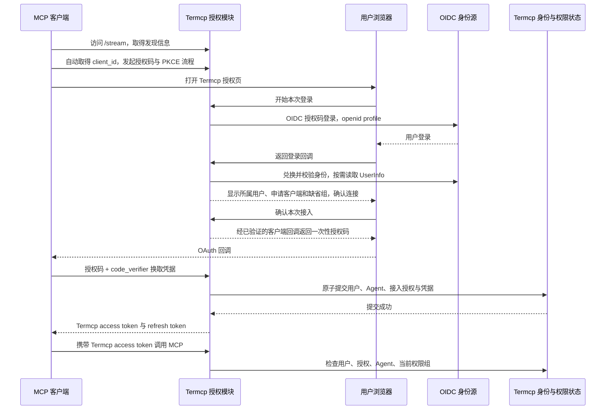

# 内置 OAuth 授权、OIDC 用户归属与 Agent 自动创建

状态：已实现（2026-11-10）。本文保留产品合同和验收依据；实现落点、限制与验证记录见文末“实现记录”。

日期：2026-11-10。

范围修订：当前外部 OAuth 实现尚未正式发布。本方案直接替换该实验实现，不为其配置、Token 或设置接口保留兼容路径；共享状态中的其他认证和权限数据单独保留。

## 1. 交付目标与硬约束

用户在支持 OAuth 的 MCP 客户端中填写 Termcp 的 MCP 地址，客户端发起浏览器授权。用户完成身份登录并确认本次接入后，Termcp 自动取得资料、创建所属 Agent、绑定缺省组；客户端自行领取、保存和刷新凭据。

```text
填写 Termcp MCP 地址
  → 客户端自动发现授权服务并打开浏览器
  → 用户登录并确认本次客户端接入
  → Termcp 获取并校验用户资料
  → 自动创建所属 Agent，加入缺省组
  → 客户端自动领取、保存凭据并连接
```

客户端侧的唯一必填配置是 MCP URL。不要求手填 Token、Agent ID、权限组、OIDC issuer、JWKS、client secret、回调地址，不要求安装 Termcp 配对程序或 stdio 桥。客户端可以要求用户点击“认证”；不能保证每种宿主都在添加服务器时自动开始登录。

这个承诺适用于具备标准 MCP OAuth 发现、客户端注册、授权码和 PKCE 能力的 HTTP 客户端。只有固定 Header、没有 OAuth 能力的客户端，继续使用现有静态 Token 接入。

新 Agent 自动创建，不以 Admin 另行批准登录为前提。业务权限由缺省组决定；如需 Admin 审批，使用初始的“未授权”缺省组，在后台调整 Agent 的组完成授权，不把客户端挂在等待审批的 OAuth 事务中。

## 2. 总体架构

Termcp 同时承担两个不同角色：

- 面向 MCP 客户端，是内置 OAuth 授权服务器和 MCP 资源服务器。
- 面向身份源，是 OIDC 登录客户端，负责取得用户身份与资料。



身份源的 Token 只用于 Termcp 后端完成登录与读取资料，不交给 MCP 客户端，不作为 MCP Bearer 使用。MCP 客户端只持有 Termcp 签发的凭据。这既消除了外部身份源必须签入 `termcp_agent_id` 的要求，也把 Agent 分配和权限决定留在 Termcp。

标准依据：MCP 允许授权服务器与资源服务器共同部署；OIDC 定义登录身份和资料获取；OAuth 的外部身份登录与本次 MCP 客户端授权仍是两个独立事务，不能共用 state、授权码或 PKCE verifier。[MCP 授权](https://modelcontextprotocol.io/specification/2026-07-28/basic/authorization)、[OIDC Core](https://openid.net/specs/openid-connect-core-1_0.html)。

## 3. 用户和 Admin 的实际操作

### 3.1 部署管理员一次配置

在“权限管理 → OAuth 接入”启用 OAuth，配置：

1. **公开访问地址**：包含 HTTPS、端口和反向代理部署前缀。用它生成 issuer、资源地址和全部回调；不从任意 Host 或 forwarded 头推导。
2. **OIDC 身份源**：issuer、Termcp 在身份源注册的 client ID、必要的 client secret。页面提供需要登记到身份源的精确回调地址，并测试 discovery 和连接。
3. **允许登录的人群**：首期接受此受信任身份源允许登录的账号；Admin 可在 Termcp 停用用户。要限制人群，应先在身份源所注册的应用中配置分配范围，不能把“选了一个通用身份源”误认为已经限制了用户。
4. **新 Agent 的缺省组**：复用现有实例级缺省组。初始值保留“未授权”；管理员可改为需要的基础权限组。

client secret 加密保存，读取设置时只显示是否已设置。更新用现有 revision 冲突检查；不增加每个 Agent 的配置向导。

首期接入一个标准 OIDC 身份源。具体使用哪一个是部署参数，不影响 MCP 客户端配置；暂不同时建设任意 OAuth 厂商资料接口、多租户后台或用户邀请系统。

### 3.2 Agent 一侧用户

1. 添加 Termcp `/stream` 地址。
2. 点击客户端提供的认证入口，浏览器进入 Termcp 登录流程。
3. 使用配置好的身份源登录；Termcp 显示“哪个客户端正在连接、当前登录用户、初始权限组”，用户确认本次连接。
4. 返回客户端，连接完成。刷新由客户端管理，不复制任何凭据。

浏览器确认只针对当前客户端接入，不要求用户选择 Agent ID、权限组或填写昵称。Termcp 自动生成 Agent 名称，Admin 后续可以改名。

### 3.3 Admin 后台

Agent 列表和详情增加：所属用户的头像/显示名、身份来源、客户端显示名、接入时间和最近使用、当前组、接入授权状态。手工创建的 Agent 显示“手工创建”，不伪造所属用户。

详情分别展示静态 Token 和 OAuth 接入，不把 access/refresh 轮换记录呈现成多枚“当前静态 Token”。活动请求、连接和后台工作计数包含 OAuth 接入；撤销操作以“本次接入”为主要管理单位。

Admin 可以调整组、停用 Agent、撤销单次接入、停用某个登录用户。登录用户只用于 MCP 归属，不因此取得 WebUI、普通 REST 或认证管理权限。

“所属用户”是申请者；Admin 调组或撤销属于管理操作，审计中另记操作者，不能把所有新 Agent 都归属为批准它们的 Admin。

## 4. 领域关系与数据模型

词汇见根目录 [GLOSSARY.md](../../GLOSSARY.md)。下列字段为方案字段，最终 Go 类型名在实现中统一。

| 记录 | 主要内容 | 不变量 |
| --- | --- | --- |
| `LoginUser` | 本地 ID、身份源、issuer、subject、显示名、用户名、头像引用、启用状态、资料更新时间 | 同一 `(issuer, subject)` 唯一；昵称/邮箱变化不改变身份 |
| `Agent` | 现有字段，新增可空 `owner_user_id`、`origin` | OAuth 自动创建时 owner 必须来自已验证登录；现有手工 Agent 保持兼容 |
| `OAuthClient` | client ID、注册方式、经校验的回调、显示资料、启用状态 | 表示应用注册，不代表用户、设备或有业务权限 |
| `AccessGrant` | ID、user ID、Agent ID、client ID、resource、scope、创建/到期/撤销、授权代际 | 固定关联本次接入的用户、Agent、客户端与资源 |
| `OAuthCredential` | ID、摘要/库签名索引、grant ID、access/refresh 类型、期限、撤销和 refresh family | 不保存明文；新 OAuth 凭据不进入现有静态 Token 的单有效凭据计数 |
| `AuthorizationTransaction` | 两段登录事务、state/nonce/PKCE 关联、浏览器绑定、配置代际、短期限 | 短期内存状态；每次确认和授权码只能消费一次 |

### 4.1 Agent 创建单位

首期采用“一次新的 OAuth 接入授权，对应一个自动创建的 Agent”：

- 一次成功的首次授权码兑换，创建一个 Agent 和一个接入授权。
- 同一授权的多个 MCP 连接、重连和刷新复用原 Agent。
- 同一个授权码被重试或并发兑换，不能重复创建 Agent。
- 客户端丢失凭据后重新进行完整授权，会创建新的 Agent。旧项保留并可在后台撤销/清理；不凭同一个 `client_id` 推测它就是原设备。
- 同一用户使用同一应用的多个接入可以独立停用。无需客户端额外提供设备 ID，也不把 `clientInfo` 当作可信安装身份。

这个选择优先保证客户端轻配置和独立撤销。首期不增加浏览器里的“选择已有 Agent”步骤；如以后需要合并，由明确的管理操作处理，不能凭用户名或应用名称自动合并。

### 4.2 缺省组只用于首次分配

自动创建时读取当前可用的缺省组，将具体 group ID 写入新 Agent；不留空依赖动态回退。后续刷新、资料更新、重连均不改组。Admin 修改实例缺省组只影响之后自动创建的 Agent，不批量移动已经创建的 OAuth Agent。

缺省组缺失或已停用时停止新接入，在授权页说明需要 Admin 修复；不自动换为更宽的组。现有手工 Agent 的空绑定兼容行为不因本方案被顺带改变。

## 5. 协议与发现

### 5.1 路由

以下为拟议路径，统一挂在配置的部署前缀下；现有 `/oauth` 保留为 Admin 设置页面。

| 路由 | 使用者 | 作用 |
| --- | --- | --- |
| `/.well-known/oauth-protected-resource` 及 path-specific 变体 | MCP 客户端 | 沿用现有发现入口，指向 Termcp issuer |
| `/.well-known/oauth-authorization-server` 的 RFC 8414 对应位置 | MCP 客户端 | 发布授权地址、兑换地址、PKCE 和客户端注册能力 |
| `/oauth/authorize` | 客户端浏览器 | 校验请求，开始登录，展示本次接入确认 |
| `/oauth/continue` | 客户端浏览器 | 有事务绑定和 CSRF 的确认 POST；GET 不批准 |
| `/oauth/oidc/callback` | OIDC 身份源经浏览器返回 | 校验上游登录并继续原授权事务 |
| `/oauth/token` | MCP 客户端 | `authorization_code`、`refresh_token` |
| `/oauth/register` | 支持 DCR 的 MCP 客户端 | 自动注册 public client，受限流和配额约束 |
| `/oauth/revoke` | 持有凭据的客户端 | 标准凭据撤销，校验客户端与凭据关联 |

公开 issuer 使用部署根地址，例如 `https://termcp.example.com/termcp`；MCP resource 首期固定为对应的 `/stream` 完整地址。发现路径必须按 RFC 8414/RFC 9728 的路径规则生成，并覆盖反向代理前缀测试，不能把 well-known 一律拼到前缀后。

已有 SSE 作为兼容入口保留；metadata、SSE `/message` 与 Token audience 使用同一配置的逻辑资源，不能用“任一 aud 或 resource 碰巧匹配”绕过目标资源检查。首期原生客户端验收主路径为 Streamable HTTP。

### 5.2 客户端自动注册

首期同时实现 CIMD 和 DCR，以覆盖目标 MCP 宿主的自动注册。支持预注册以便部署兼容，但不能把人工填写 client ID/secret 作为标准接入步骤。

CIMD 校验文档 URL、client ID 一致性、回调和结构；远程获取限制 HTTPS、大小、超时、重定向和网络目标，防止 SSRF。DCR 限定 public client、授权码与 refresh、合法回调，不允许通过注册元数据请求 Agent、Admin role 或权限组。注册成功只获得发起登录的资格，没有业务权限。

loopback 回调严格校验 host/path，并支持客户端依法选择动态端口；非 loopback 回调要求受验证的 HTTPS 地址。不能开放任意重定向，也不能要求用户每次把动态端口登记到后台。[MCP 客户端注册](https://modelcontextprotocol.io/specification/2026-07-28/basic/authorization/client-registration)、[RFC 8252](https://www.rfc-editor.org/rfc/rfc8252.html)。

注册、未完成授权事务和自动建档均设置服务端配额与限流。新 Agent 继续遵守现有实例数量上限，并增加每个登录用户的有界接入数量；耗尽时向客户端返回明确失败，Admin 可以清理失效接入。不能让匿名 DCR 请求提前占满 Agent 数量，也不自动删除仍有有效授权的 client 注册来回收空间。

### 5.3 授权和凭据

- 下游 public client 强制授权码 + PKCE `S256`；不提供密码 grant 或 implicit grant。
- 请求与授权码绑定 client、精确回调、resource、scope、PKCE、事务和配置代际；客户端发来的 state 原样返回，服务端另有浏览器事务绑定。
- 内置 issuer 发布并正确执行 RFC 9207 issuer response identification；成功与可安全回调的错误响应都包含准确 issuer。
- MCP scope 首期保持 `mcp`。请求范围与 refresh 权限由服务端白名单决定，不把所有业务动作复制成另一套权限组；具体业务权限继续用 AgentPolicy。
- 若提供 `offline_access`，只在授权服务器 metadata 和合适的授权流程中声明；不把它放进 MCP 资源要求的 challenge。
- 内置 access token 使用成熟 OAuth 实现提供的 opaque token 策略；保存摘要/索引，反查本地授权，不要求新签 JWT 或对外提供 ID Token。
- 首次兑换原子创建用户归属、Agent、grant 和凭据，提交成功后才返回秘密。失败不留下可用凭据或半个 Agent。
- 授权码只兑换一次；网络丢失后的重放按标准失败，不重复创建实体。客户端可以重新开始授权。

建议初始期限：浏览器事务 10 分钟、授权码 60 秒、access token 10 分钟、refresh family 绝对期限 30 天。实际到期以记录中的服务端时间为准；刷新不能延长 family 的绝对期限。这里是本方案初始产品值，不是 OAuth 规范强制值。

内置服务器 metadata 至少声明 `authorization_code`/`refresh_token`、`code`、public-client 的 `none`、PKCE `S256`、`mcp`/`offline_access`、CIMD 能力、DCR 地址和 issuer response identification。支持客户端在正常授权中申请 refresh；不要求用户另填 scope。下游 MCP scope 与上游 `openid profile` 分开，不能让客户端任意增加上游身份资料权限。

## 6. 登录资料与头像

Termcp 使用固定的服务端 OIDC client 请求最小 `openid profile`；首期不为展示头像额外索取 email、通讯录或其他资源权限。

使用 OIDC discovery 和 Token 校验模块校验签名、issuer、audience、期限，并由应用校验本次 nonce、上游 state、必要的 authorized-party 约束。读取 UserInfo 时必须与已验证 ID Token 的 subject 一致。资料来源是用户在 Termcp 授权页登录的身份源，不是假定能读取 MCP 宿主自身登录账号的资料。[OIDC UserInfo](https://openid.net/specs/openid-connect-core-1_0.html#UserInfo)、[稳定身份](https://openid.net/specs/openid-connect-core-1_0.html#ClaimStability)。

显示名优先使用 `name`，再用 `preferred_username`；均缺失时生成本地显示名。头像缺失、地址失效或加载失败时使用默认图形，不阻断登录。显示字段只作展示，更新这些字段不能改用户 ID、Agent 归属或权限。

头像由有界后端缓存取得，不直接让管理页面加载任意资料 URL。限制 HTTPS、目标网络、重定向、体积和解码尺寸，重编码为受支持的栅格格式；失败降级默认图形。私网身份源如需要私网头像，只能由 Admin 明确允许对应来源，不能由用户 profile 扩展网络访问范围。缓存是可丢弃数据，访问仍受 Admin 页面权限约束。

上游 access token 只在本次登录取资料时使用，首期不保存上游 refresh token。资料在后续真实登录时更新；下游 refresh 不重新向身份源登录，也不伪称它能实时发现外部账号已被停用。

## 7. 权限、撤销和会话

每次 MCP 请求都必须先满足认证边界：凭据有效、grant 有效、用户启用、Agent 启用、角色允许 MCP，以及目标 resource/scope 正确。组是否存在、是否启用，以及具体 AgentPolicy 是否允许某个动作，在业务调用边界实时解析。

“认证完成、组内没有业务动作”是正常状态，不返回假的认证失败。客户端可完成 MCP 初始化；业务调用按照当前权限层拒绝。Admin 调整组、动作、约束或主机范围后使用当前策略，不轮换凭据、不撤销 grant、不注销 MCP session，也不要求用户重新复制 Token。失去权限的后台工作按明确的 operation/host authority 取消，无关工作保留。

Modifying the default group only affects later OAuth Agents; existing Agents keep their explicit group. Agent/user/login-client/grant revocation and vault locking are identity failures: they terminate affected connections and work after the encrypted state commit succeeds.

### 7.1 刷新与重放

refresh 每次轮换并绑定同一个 grant、client 和 resource；不能改 owner、另建 Agent、扩 scope 或重置组。旧 refresh 被再次使用时，按复用检测撤销该 family，并拒绝其派生凭据。首期不添加允许旧 refresh 无限复用的兼容开关；真实客户端并发刷新行为必须纳入验收。

access token 仍是 Bearer，泄漏后在有效期内存在重放风险。短期限和本地即时撤销缩短影响，不能描述为已防重放。DPoP/mTLS 不作为首期客户端前置条件；之后可作为需要双方支持的增强。[RFC 9700](https://www.rfc-editor.org/rfc/rfc9700.html)。

### 7.2 撤销层级

| 操作 | 结果 |
| --- | --- |
| 撤销一个 access token | 此 Token 的后续请求与绑定活动结束；不默认禁止原 refresh 继续发新 Token |
| 撤销一个接入授权或 refresh family | 此次接入的 access/refresh 全部失效；客户端需要重新进行完整授权 |
| 停用 Agent | 所有相关接入失效，后台工作停止 |
| 停用登录用户 | 其名下全部 OAuth 接入失效；不删除审计归属 |
| 停用身份源、内置 OAuth 或改变 issuer/登录信任配置 | 取消旧登录事务并终止受影响授权；恢复配置不自动复活旧凭据 |

Admin 撤销用户或 grant 后，后续普通登录不应悄悄复活已停用用户或已撤销记录。允许重新申请的新授权，与恢复原记录是不同操作；停用用户始终拒绝。

外部账号在 IdP 被停用，首期不承诺毫秒级同步到已发出的 Termcp 凭据。Admin 可本地停用用户；grant 最长期限控制重新登录窗口。若部署要求实时同步，另做身份源事件或在线检查，不能以“启用 OIDC”代替这项能力。

### 7.3 MCP 会话归属

将已验证的 grant ID 带入请求上下文与 transport owner。刷新接续 MCP session 必须匹配同一个 grant、Agent、client 和 resource，不能只看相同 Agent ID；静态 Token 继续按现有精确凭据规则隔离。

Streamable HTTP 使用 session 时，有效 Bearer 携带未知/过期/terminated session 返回 404；session 仍存在但归属不匹配返回 403；无效 Bearer 返回 401。客户端可沿用同一 grant 重新 `initialize`。SSE 按 GET event stream 和 `/message` endpoint 的语义独立重建。自管 stdio bridge 允许有界、可取消地重握手，但请求一旦可能已经执行，就返回可识别的“结果未知”，不自动重放命令、按键、文件写入或删除。

请求受当前 access token 期限约束。刷新不复活已经结束的请求或任务；新凭据可以重新发起请求。后台任务继续使用既有权限生命周期规则，并纳入 Token/grant 撤销；不为 OAuth 引入永久有效的任务上下文。

## 8. 持久化、锁与故障恢复

用户、owner 引用、OAuth client、grant、凭据摘要/family、内置设置与身份源 secret，进入现有加密 auth 对象，复用 local-state 的原子发布。头像二进制不塞入 auth JSON；加密资料仅保存缓存引用和展示资料。参考 [local-state 合同](local-state-and-passwords.md)。

OAuth 库的 Token 策略若需要 HMAC/system secret，生成独立的高熵密钥并加密持久化；不能借用每次进程启动都会更换的 Web Cookie JWT 密钥。重启不得因 Token 策略换密钥而意外作废全部 MCP 凭据。主动轮换此密钥时按凭据代际处理旧授权失效。

必须更新所有状态复制、校验、序列化、新字段初始化和容量限制路径；当前 `credentialState` 只复制 Groups/Agents/Tokens，不能给新 map 做浅拷贝后并发写。旧实验 OAuth 字段直接废弃，具体处理见第 10 节。

事务要求：

1. 登录网络请求、JWKS/UserInfo/头像获取、Token 生成和可能较慢的库工作均在状态锁外进行，且可取消、有超时。
2. 获取短期状态快照和 revision。提交时重新检查用户/配置/缺省组是否仍有效。
3. 将授权码消费、用户 upsert、Agent/grant 创建、凭据索引作为一次原子状态变更；refresh 的消费、重放处理、新凭据写入也必须原子化。
4. 对保存序列使用可取消的一槽 channel，按受影响分区 revision 复核并合并其他并发修改。持有普通互斥锁时只做短内存状态切换，文件写入和外部回调在锁外。
5. 复用既有加密对象提交点，不另外增加一个可能与权限状态分叉的明文凭据数据库。持久化结果不明确时按现有 durability 合同处理，不能简单回滚已发布的权力变化。
6. 状态已发布后，再在锁外取消任务、通知和关闭连接。锁定保险库后，内置 OAuth 也不能签发/刷新或授权业务访问。

现有 `Managed.save` 在多个持锁调用点执行文件保存，首期需要为受影响的认证写入引入明确的提交协调，不能只把新 OAuth 网络调用移到外面就声称符合并发约束。改造必须覆盖 Admin 并发调组与 OAuth 创建/刷新，防止覆盖更新；不扩成全仓储重写。

重启保留用户、Agent、grant 与凭据撤销状态；未完成的浏览器事务和授权码失效，用户重新开始授权。保险库锁定时公开发现只允许返回必要的已配置公开地址/能力，不泄漏身份源 secret 或用户资料。客户端凭据不能解锁配置，外部身份登录也不能自动取得 Main Key。

审计记录用户/Agent/grant/client 的本地引用、操作和结果，不记录原始 Token、授权码、state、nonce、verifier、client secret 或完整原始 claims。浏览器授权页和兑换响应使用禁止缓存策略，授权页不加载第三方脚本；头像昵称只在受保护后台展示。

## 9. 模块与代码落点

新增 `internal/oauthserver` 作为 OAuth/OIDC 协议 module，隐藏两段浏览器事务、客户端注册、授权码、Token 与 refresh 的 implementation。外部 interface 保持为 HTTP handler、Token 校验和配置应用；MCP 层不读取 OIDC 原始 claims。

优先使用 Fosite 作为 OAuth 协议引擎、`go-oidc/v3` 与 `x/oauth2` 承担 OIDC 登录。Fosite 已有 PKCE、refresh 和事务 storage 扩展点；并不因此自动获得 MCP discovery、CIMD、Termcp 业务建档或正确的权限事务。`go-oidc` 的 verifier 也不代替应用比较本次 nonce。[Fosite](https://github.com/ory/fosite)、[go-oidc](https://github.com/coreos/go-oidc)。

将现有加密身份状态作为真实 storage adapter，在协议 module 与 `internal/auth` 之间设 seam：协议只接受已验证的登录意图，身份层决定 user、Agent、缺省组和 grant，策略层仍决定业务权限。禁止协议 module 接受客户端提供的 owner、Agent ID、group 或 role 来替代这次决定。

第一个实施任务验证 Fosite 的授权码/refresh storage 事务如何合并到本地原子提交，尤其是 PKCE 消费、授权码消费与 Agent 创建的一致性。需要显式事务 adapter，不能用每个 storage 回调单独 `save`。若框架默认路径在此约束下不成立，先改 adapter 设计，再展开 UI；不在实施末期用不完整的手写 OAuth 流程补洞。

| 落点 | 改动责任 |
| --- | --- |
| 新增 `internal/oauthserver/` | 协议引擎封装、发现、注册、OIDC、授权事务、有界 HTTP 获取 |
| `internal/auth/managed.go`、`managed_storage.go`、`managed_tokens.go` | 用户/归属/grant 状态、复制校验初始化、统一提交；保留现有静态 Token 行为 |
| `internal/auth/oauth.go`、`oauth_settings.go`、`managed_http.go` | 移除实验外部 JWT 准入与旧设置模型，接入内置授权；Admin Cookie 与 OIDC 浏览器事务隔离 |
| `internal/auth/groups.go` | 复用策略解析和缺省组；新建时显式绑定，刷新时不重新分配 |
| `internal/auth/background_work.go`、`internal/mcp/auth_transport.go` | grant 级撤销、活动取消、刷新后的会话归属 |
| `internal/auth/permissions.html` 及 OAuth 设置页面 | 所属用户/头像/来源、接入授权状态、Admin 设置与撤销；沿用现有主题与响应式布局 |
| `docs/clients.md`、当前 OAuth 设计与认证范围文档 | 实现交付时更新用户接入步骤、能力状态与部署方式 |

不要复用现有每 Agent 单枚静态 Token 的 rotate 语义存放 OAuth access/refresh。保持两个凭据生命周期，通过共同的 AgentPolicy 和取消机制汇合。

## 10. 替换实验 OAuth 与开发数据处理

### 10.1 处理原则

当前外部 OAuth 代码未正式发布，不存在需要维持的 OAuth 用户升级合同。直接采用新的内置授权实现：

- OAuth 只保留启用/停用，不提供 `external`/`builtin` 模式选择。
- 删除外部 access JWT 作为 MCP 凭据的验证路径，删除自定义 Agent claim 映射和对应设置、文档示例、测试夹具。
- 不建立旧 Token 换新 Token、旧 issuer 继续受信任或认证失败后回退旧验证器的路径。
- 不保留旧 `OAuthConfig`、`SetOAuthConfig` 等实验入口的兼容包装。原 `/auth/oauth` 路由可以继续用于设置，但请求和响应直接使用新模型。
- 本次替换不重置本机 Admin、静态 Token、Agent、组、主机配置或加密密钥。它们与实验 OAuth 不是同一类待废弃数据。

本节所说的开发数据处理是“丢弃旧 OAuth 设置、配置新功能”，不把旧外部 OAuth 模式转换为新内置模式，也不增加一个长期维护的旧 schema 解码分支。

### 10.2 新旧字段明确分开

在共享认证状态中删除原 `OAuth` 字段及其 `json:"oauth"` 设置模型，新增 `OAuthServer` / `json:"oauth_server"`。新对象包含启用状态、revision、公开访问地址、OIDC 身份源配置及内置授权所需设置。新的用户、client、grant、凭据集合按各自字段初始化。

| 当前实验字段/状态 | 新方案处理 |
| --- | --- |
| `oauth.enabled` | 不继承；`oauth_server` 缺失时视为未配置、停用 |
| `oauth.issuer` | 丢弃；它原本表示 MCP Token 的外部签发者，不能自动当作新 OIDC 登录源 |
| `oauth.resource` | 丢弃；Admin 在新设置中确认公开地址，再派生资源地址 |
| `oauth.jwks_url` | 丢弃；新登录模块按已配置 OIDC 身份源发现密钥，不接受此旧值延续信任 |
| `oauth.agent_claim` | 删除此能力；Agent 和 owner 由本地授权事务决定 |
| `oauth.scope`、`oauth.revision` | 不继承；新 scope 策略和 revision 使用新模型 |
| 外部 access/refresh Token | 不导入、不转换、不继续验证；新凭据必须通过新流程领取 |
| 实验验证器的 JWKS 缓存、`oauthSessions` 与连接归属 | 进程内状态随替换重启结束；不恢复到新授权 |

当前认证状态读取使用普通 `json.Unmarshal`。移除旧 `oauth` Go 字段后，读取同一份有效 JSON 时该未知键自然不参与新状态；不需要先解析它、判断旧格式或写字段映射。下一次正常保存只序列化新模型，旧键从新的 auth 代际中消失。新代码不能为了兼容旧 OAuth 额外放宽其他状态校验。

新设置接口仍严格检查请求字段。来自旧页面的 `issuer/resource/jwks_url/agent_claim` 请求应被拒绝，不能一边忽略旧请求字段一边返回“保存成功”。磁盘状态的正常未知键处理与设置接口的输入校验是两回事。

### 10.3 共享认证状态如何保留

| 数据 | 处理 |
| --- | --- |
| Admin 身份、登录校验记录、实例 ID | 保留；继续使用原登录入口 |
| Main Key、EDK、配置对象引用和主机配置 | 保留；不因 OAuth 替换轮换或重建 |
| 现有 Agent 的 ID、名称、启用状态和组绑定 | 保留；新增 owner 为空，来源为手工创建 |
| 静态 Token 摘要、期限、撤销和替换历史 | 保留；现有客户端不需要重配静态 Token |
| 权限组、缺省组和权限修订 | 保留；不能调用首次初始化逻辑覆盖现有组 |
| 新增登录用户、client、grant、OAuth 凭据集合 | 缺失时初始化为空；不从旧 JWT 或旧 Agent 名称反推用户归属 |

这里的初始化属于新增字段的正常状态定义，不单为实验 OAuth 引入认证版本升级器。仍沿用现有认证版本校验和加密对象提交合同；其他原因造成的不支持版本、损坏数据或错误密码不能被当成“清理 OAuth”而静默重置。

禁止通过删除整个 auth 对象、data-dir、local-state 或重做 Admin setup 来完成本次替换。旧 OAuth 字段与 Agent/静态 Token 共存在认证对象中，整对象清空会误删需要保留的数据。

### 10.4 开发实例切换步骤

1. 停止实验版实例并启动新实现。旧进程的连接和浏览器授权事务结束，不做热迁移。
2. 使用现有本机 Admin 登录并解锁。新读取模型保留非 OAuth 状态，不使用磁盘上的旧 `oauth` 配置，OAuth 初始停用。
3. Admin 打开新 OAuth 设置，确认公开访问地址，配置 OIDC 身份源并完成连接检查，然后启用。此次正常保存通过既有加密提交点写入新状态，旧 `oauth` 键不再写出。
4. 之前参与 OAuth 实验的客户端，清除该服务器缓存的实验 OAuth 凭据，再点击原生认证入口。MCP URL 相同就保留地址；新的普通用户仍只需填写 URL 并在浏览器登录。
5. 首次新授权创建有 owner 的 Agent；原有手工 Agent 和静态 Token 不被自动接管、合并或删除。开发者可在后台明确清理不再需要的实验 Agent。

无需编写旧配置导入工具，不要求开发者手工编辑加密文件。若使用全新临时 data-dir 验收，则直接初始化新实现；这与在已有开发数据上保留非 OAuth 状态是两种测试场景，不互相替代。

### 10.5 实现中移除和保留的代码

- 移除实验外部 JWT 准入、旧设置归一化、`termcp_agent_id` 映射及相关页面字段；`validateState` 不再验证旧 `s.OAuth`，改为校验新的内置设置和集合。
- OIDC 上游 ID Token 的 JWT/JWKS 验证仍由登录模块负责。这是验证登录用户，不是保留外部 access JWT 作为 MCP 凭据的旧路径。
- 保留可复用的 MCP protected-resource metadata、401 challenge、AgentPolicy、静态 Token 准入和活动取消逻辑，并把发现信息改为指向新 Termcp issuer。
- 替换 OAuth 专项测试及实例构造方式，不保留“旧实验外部模式继续认证成功”的测试要求。静态 Token、权限组、Admin 登录与加密存储原有回归检查继续执行。

### 10.6 替换验收

| 输入/操作 | 必须满足 |
| --- | --- |
| 有旧 `oauth.enabled=true` 的当前开发状态 | 新 OAuth 仍停用，Admin/Agent/组/静态 Token 保留 |
| 保存一次新设置后重新读取 auth 状态 | 存在 `oauth_server`，不再输出旧 `oauth`；其他状态保持一致 |
| 携带实验外部 JWT 请求 MCP | 认证失败，不回退旧验证器、不自动建用户或 Agent |
| 旧 OAuth 页面格式提交设置 | 明确拒绝，不覆盖新配置 |
| 已有静态 Token 连接 | 原凭据继续有效，入口与权限限制不变 |
| 新浏览器登录与后续刷新 | 只使用新授权事务、用户归属与本地 grant |
| 状态损坏、版本不支持或解锁失败 | 依现有合同报错，不重做 setup 或清空数据 |

本方案扩展“内置授权、登录用户资料、Agent 归属和接入授权”，仍不引入一般成员后台、多租户或 Admin OIDC 登录。旧设计文档可以记录实验实现的历史行为，但不能再把它写成需要保留的已发布兼容合同。

## 11. 分阶段实施与验收

### 阶段 A：打通第一个完整接入

完成协议 module、存储事务 adapter、用户归属与显式缺省组绑定。用临时 OIDC 测试身份源跑通 discovery → 自动注册 → 浏览器登录确认 → 兑换 → Agent 自动创建 → `/stream` 初始化。资料不全时仍能登录，默认未授权组不允许业务动作。

### 阶段 B：完成权限与凭据生命周期

交付 refresh 轮换、grant 会话归属、即时撤销、用户/Agent/组停用、后台取消、重启/保险库锁定行为。覆盖并发 Token 兑换、Admin 并发调组、配置变化中的 OIDC 回调、存储失败与不明确 durability 结果。

### 阶段 C：完成后台与实验实现替换

交付内置设置、用户头像与归属展示、grant 管理和审计；验证旧实验 OAuth 配置被废弃、外部 JWT 不再准入，同时保留共享状态中的静态 Token、既有 Agent 和权限组。完成真实目标客户端和代理前缀验收，之后才标记可发布。

### 必须通过的功能与安全案例

| 场景 | 验收结果 |
| --- | --- |
| 首次配置支持 OAuth 的目标 MCP 客户端 | 仅填 MCP URL，点击认证并在浏览器登录；没有手工凭据步骤 |
| OIDC 首次登录 | 后台出现用户资料、归属 Agent 和正确缺省组 |
| 拒绝登录/拒绝本次连接/身份校验失败 | 不产生可用 grant、凭据或幽灵 Agent |
| 相同授权码并发兑换、回调重放 | 最多一次创建，无重复实体或凭据泄漏 |
| access 到期后 refresh、多个 MCP 连接重连 | Agent/owner/group 不变，接入授权相同 |
| 用户昵称变化、头像缺失/失败 | 只更新展示；身份与权限不变 |
| Admin 更换缺省组 | 只影响之后新建的 OAuth Agent |
| Admin 调整既有 Agent 的组 | 当前策略生效，客户端无配置变更 |
| 跨用户、跨 grant 或跨 resource 使用 session ID | 拒绝接续 |
| 停用用户/Agent/组、撤销 grant、复用旧 refresh | 正确拒绝后续访问并取消相关活动；重启仍有效 |
| 伪造 profile、owner、group、role、Agent ID | 无法影响服务端归属与权限决定 |
| 跨站确认、无效 state/nonce/PKCE、非法回调 | 拒绝；不能经不可信回调带走授权码 |
| CIMD/头像获取的私网跳转或恶意内容 | 有界拒绝或降级，不影响其他认证请求 |
| 保险库锁定或身份源不可用 | 明确失败，不开放业务，不让用户复制管理凭据绕过 |
| 代理前缀、不同端口、loopback 动态回调 | 发现、授权、Token 和回调保持同一可信配置 |
| 实验 OAuth 配置与外部 JWT | 不继承、不接受，没有旧验证器回退 |
| 现有静态 Token 与手工 Agent | 数据保留，原有入口限制和生命周期保持通过 |

实现阶段依照 [测试规范](../agents/testing.md) 和 [权限生命周期矩阵](../agents/permissions-testing.md) 运行 `make test-permissions`、`make test`、相关包 `make test-stress`，并验证 `no_webui` 构建。OAuth 授权页是认证必需内容，不能因业务 WebUI 被裁剪而缺失。

真实客户端验收至少包含 Codex 的 URL 添加/浏览器登录/自动刷新，以及目标 Claude 客户端的同一流程。用隔离实例、虚构账号和临时身份源完成；具体平台和客户端版本记入验收记录，未执行的平台不能用编译代替通过。Codex 原生认证入口与自动注册见 [官方 MCP 文档](https://learn.chatgpt.com/docs/extend/mcp?surface=cli)。

## 12. 交付判定

只有阶段 A、B、C 全部通过，才把此能力描述为可用。最核心的验收问题只有一个：一个从未连接过此实例的用户，能否只输入 Termcp 地址、完成浏览器登录，就在后台看到有真实用户归属且权限正确的 Agent，并在之后无需手工管理 Token 地继续使用。

## 13. 实现记录

2026-11-10 的交付包含：

- `internal/oauthserver`：Fosite 协议引擎、opaque token strategy、CIMD/DCR client model、RFC 9728/RFC 8414 metadata、有界 SSRF-safe fetcher、OIDC discovery/token/UserInfo 校验。
- `internal/auth`：`oauth_server` 加密设置、login user、owner、client、grant、authorization code、access/refresh credential 状态；Fosite transactional storage adapter；统一的可取消提交队列。
- 授权、回调、确认、token、registration、revocation 路由与静态 HTML 确认页；授权响应带 RFC 9207 `iss`。
- MCP grant/client/resource 会话绑定；OAuth 请求、后台工作和 transport 的 grant 级取消。
- Admin 设置、所属用户/头像/客户端/grant 展示，以及用户停用、grant 撤销和 Agent 生命周期联动。

验证覆盖临时 OIDC 身份源下的 DCR、浏览器登录/拒绝/重复回调、S256 PKCE、并发授权码兑换、Agent 默认组创建、动态调组、缺省组切换、refresh 轮换与复用撤销、重启、保险库锁定、OAuth 设置变更、存储失败、CIMD 校验/缓存、静态 Token 回归，以及真实 mcp-go Streamable HTTP initialize 和 refresh 后续接。此类测试证明协议和传输实现，不等同于对某个外部 Codex/Claude 客户端版本的实机兼容性验收；没有隔离测试账号和对应客户端环境时必须在交付报告中明确列为未实测。

2026-11-11 的隔离原生客户端验收补上了这一点：`codex-cli 0.166.0` 在只提供
`--url http://127.0.0.1:18990/stream` 的情况下自动选择 CIMD，Termcp 获取其公开
`https://chatgpt.com/oauth/codex/client.json` 文档，完成动态 loopback 端口、
OIDC 登录、确认、授权码/PKCE 和凭据保存；客户端报告 `auth_status=o_auth`，
后台出现正确 owner、缺省组、client 与 grant。另一个隔离运行强制 DCR 后同样成功。
该次验收没有等待 Codex 的 10 分钟 access token 自然到期，因此 Codex 内部自动刷新
仍由后续客户端实机验收确认；refresh 轮换和服务端 MCP session 接续已由 mcp-go
集成测试覆盖。Claude 客户端未安装，未宣称实测。
